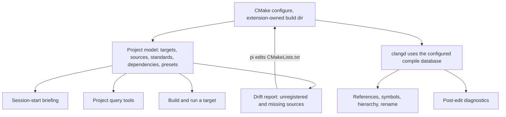
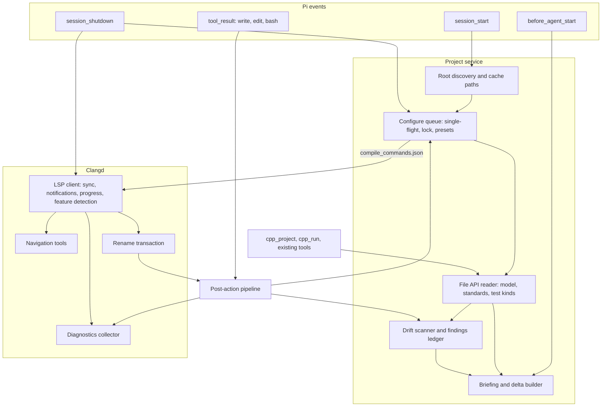
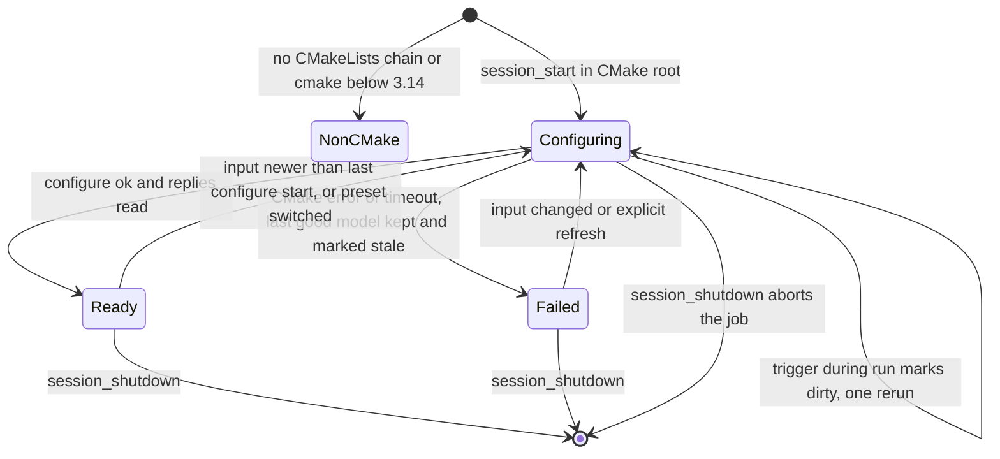
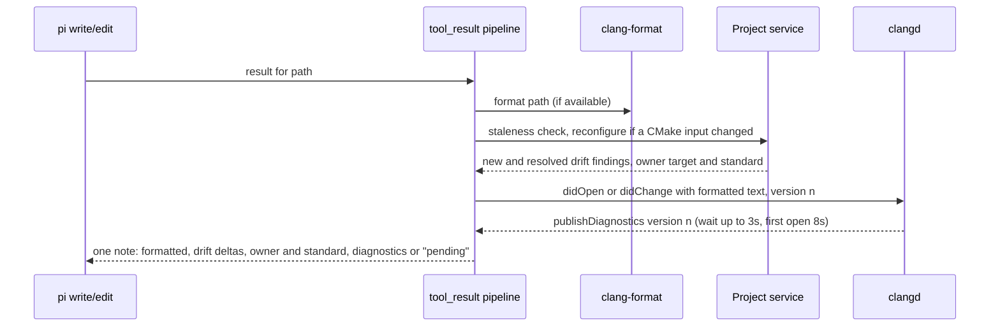

# CMake Project Intelligence - Plan

## Goal Capsule

- **Objective:** When pi works in a CMake C/C++ project, it understands how the project is built before it edits code, it navigates the code semantically instead of by grep, and new, moved or deleted source files end up correctly registered in `CMakeLists.txt` without the user having to catch the gap.
- **Means:** An extension-managed CMake configure read through the CMake File API, pushed to pi as a session briefing and per-action drift reports, plus an upgraded clangd client (KTD1, KTD5, KTD11).
- **Product authority:** The Product Contract below owns behavior. On implementation mechanism, the Planning Contract's KTDs win within the cited R constraints. The repo owner decides any scope change.
- **Stop conditions:** Stop and ask if a KTD proves infeasible against real CMake or clangd behavior in a way that would change a requirement, for example if clangd cannot keep its index outside the project tree (KTD11).
- **Execution profile:** One release, delivered as the dependency-ordered units below. Units can land as separate commits on one branch.
- **Open blockers:** None.

---

## Product Contract

### Summary

The extension builds a CMake project model in the style of CLion. It configures the project, gives pi a compact briefing at session start, and reports source files that are out of sync with CMake so that pi fixes `CMakeLists.txt` itself. The release also adds clangd navigation (references, symbol search, call and type hierarchy, rename) and attaches clangd diagnostics to pi's edits. Everything ships in one release.

### Problem Frame

When pi opens a C++ project, it starts coding before it understands how the project is put together. It does not know which targets exist, which files belong to them, or which C++ standard each target uses. It finds code by grepping instead of asking clangd.

`CMakeLists.txt` drifts in two ways. Pi creates or moves source files and never registers them. Between sessions, people add, move or delete files and edit `CMakeLists.txt` outside pi, which is a shared file the whole team edits. Pi then starts from a stale picture of the project, and the gap only shows up as a link failure later.

Today the extension has no view of the project. The system-prompt guidance is three fixed strings that never look at the project (`extensions/index.ts:54-61`). The only clangd requests are hover and definition (`extensions/lib/clangd.ts:146`). clangd's diagnostics are dropped (`extensions/lib/clangd.ts:99-105`). Nothing compares the files on disk with CMake's target sources.

---

### Key Decisions

- **Ship the CMake project model and clangd navigation together, at full scope, in one release.** (session-settled: user-directed — chosen over planning each area separately or shipping a smaller first slice: the user wants a single big release.) Governs R1–R28.
- **The extension detects drift and pi edits `CMakeLists.txt`. The extension never rewrites build files.** This works with any CMake layout and keeps the project's own conventions. (session-settled: user-approved — chosen over the extension auto-editing simple source lists, or only warning: auto-editing would mean owning a CMake editor that fights team conventions.) Governs R15, R16.
- **Orientation is pushed automatically at session start, not left to pi to request.** The failure being fixed is pi skipping orientation, so a tool plus a nudge would leave that failure in place. (session-settled: user-approved — chosen over a tool with a system-prompt nudge, or a hard gate that blocks edits until pi orients: the nudge can be ignored and the gate adds friction to small edits.) Governs R6, R7.
- **The extension configures the project itself, as CLion does.** (session-settled: user-approved — chosen over reusing only an existing build directory, or asking the user at session start: reuse-only gives a degraded briefing on stale projects, and asking interrupts most sessions.) Governs R1–R4.
- **All four clangd capabilities are in scope, including project-wide rename.** (session-settled: user-directed — the user picked all of them after seeing that rename is a riskier multi-file write.) Governs R21–R25, R28.
- **Rename refuses rather than applying a partial or out-of-project edit.** A partial rename breaks the build, so a clear refusal beats an incomplete success. (session-settled: user-approved — proposed in the plan synthesis with the trade-off shown, and the user confirmed.) Governs R28.
- **The project model always comes from CMake's current view of the project, never from a remembered snapshot.** `CMakeLists.txt` is edited by everyone, so cached knowledge goes stale between sessions. Governs R5, R12.
- **Drift means current mismatches, not a change history.** The briefing reports what is out of sync now. It does not report what changed since the last session, which would need state stored across sessions. Governs R10, R11.
- **The project model drives the C++ standard guidance.** The original "C++11 and up" goal is met by telling pi each target's actual standard, which replaces the generic guidelines. Governs R9.

---

### Requirements

**Configuration**

- R1. In a CMake project, the extension configures the project at session start when there is no current configuration, or when `CMakeLists.txt` files or presets changed since the last configure.
- R2. Auto-configuration writes to a build directory owned by the extension and never modifies the user's own build directories.
- R3. When `CMakePresets.json` or `CMakeUserPresets.json` defines configure presets, the extension picks a default preset automatically. The user can switch presets with a command, and the choice is remembered per project.
- R4. Configuration does not block the session from starting. Until it finishes, pi is told the project model is still loading. Configure failures, including CMake errors, missing dependencies and timeouts, are reported to pi with the relevant CMake output, and the existing tools keep working.
- R5. When any `CMakeLists.txt`, preset file or included CMake module changes during a session, whether pi or someone outside pi made the change, the extension reconfigures before it next reports on the project.

**Briefing and project queries**

- R6. At session start pi receives a project briefing. It covers the targets and their kinds (executable, library, test), the directories each target owns, each target's C++ standard, dependencies between targets, the active preset and configuration, how to build and run tests, and any current drift findings.
- R7. The briefing stays within a fixed size budget. On projects too large to list fully, it summarizes at target level and points pi to the project query tool for details.
- R8. Pi can query the project model: list targets, show a target's sources, include directories, defines, standard and dependencies, and find which target or targets own a given file.
- R9. Pi is told to write code that is valid for the C++ standard of the target that owns the file being edited. The fixed generic guidance in the system prompt is replaced by this project-aware guidance.

**Drift detection**

- R10. A source file (`.c`, `.cc`, `.cpp`, `.cxx`) inside the project tree that belongs to no target is reported as unregistered. The report names the most likely owning target and the `CMakeLists.txt` file and line where its sources are declared.
- R11. A source file listed in a target that does not exist on disk is reported as missing, with the `CMakeLists.txt` file and line that lists it.
- R12. Drift is checked at session start, and again after any pi action that creates, moves or deletes files. That includes the write and edit tools and shell commands such as `mv`, `git mv` and `rm`.
- R13. Headers are never reported as unregistered.
- R14. Build directories, the extension's own build directory, and paths the project ignores (for example through `.gitignore`) are excluded from drift detection.
- R15. When the likely owning target collects its sources with `file(GLOB...)`, the report says the fix is a reconfigure rather than an edit. The extension reconfigures and confirms whether the file is now registered.
- R16. After pi edits a `CMakeLists.txt`, the extension reconfigures, checks drift again, and reports to pi whether the findings are resolved, along with any configure error the edit caused.

**Targets**

- R17. Pi can build a specific target using the active preset and configuration.
- R18. Pi can run an executable target with arguments. Timeout, cancellation and output capture work as they do for the existing build and test tools.
- R19. The existing compile, check, build, test and clangd tools default to the extension's configured project when the caller passes no build directory, and explicit build directories still override that default.

**clangd navigation**

- R20. clangd uses the compile database from the extension's configured project, so navigation reflects the project's real flags.
- R21. Pi can find all references to the symbol at a position.
- R22. Pi can search symbols by name across the project and list the outline of a single file.
- R23. Pi can get the incoming and outgoing calls of a function, and the base and derived types of a class.
- R24. Pi can rename a symbol across the project. The edits apply directly, the result lists every file changed, and each changed file is formatted and diagnosed as in R25.
- R25. After pi writes or edits a C/C++ file, clangd's errors and warnings for that file are attached to the tool result. The list is capped, and the step is skipped silently when clangd is unavailable, the same way auto-format is today.
- R26. When clangd's project index is still being built, results that depend on it (references, symbol search, hierarchy) tell pi they may be incomplete. Rename follows R28 instead.
- R28. Rename refuses, with the reason, when clangd's index is still incomplete after a bounded wait, or when any edit would land outside the project or inside a build or dependency directory.

**Scope of support**

- R27. Outside CMake projects, the extension behaves as it does today. There is no briefing and no drift detection, and the clangd tools keep working with whatever compile database exists.

---

### Acceptance Examples

- AE1. **Covers R10, R12.** **Given** a configured project where target `net` declares its sources in `src/net/CMakeLists.txt`, **when** pi writes a new file `src/net/socket.cpp`, **then** the write result reports that `socket.cpp` belongs to no target, suggests `net`, and points to the line in `src/net/CMakeLists.txt` where the sources are declared.
- AE2. **Covers R11, R6.** **Given** a teammate deleted `src/util/old.cpp` between sessions but left it in `CMakeLists.txt`, **when** a new session starts, **then** the briefing lists `src/util/old.cpp` as missing, with the line that references it.
- AE3. **Covers R12.** **Given** a configured project, **when** pi runs `git mv src/a.cpp src/core/a.cpp` through the shell, **then** the shell result reports the drift: `src/core/a.cpp` is unregistered and `src/a.cpp` is missing.
- AE4. **Covers R15.** **Given** target `app` gathers sources with `file(GLOB ...)` over `src/app/`, **when** pi creates `src/app/new.cpp`, **then** the report says no edit is needed, and after the extension reconfigures, it confirms the file is now part of `app`.
- AE5. **Covers R16.** **Given** an unregistered-file finding, **when** pi adds the file to the right `target_sources` call, **then** the extension reconfigures and reports the finding as resolved. If pi's edit breaks the configure step, the CMake error is reported instead.
- AE6. **Covers R4.** **Given** configure fails because a FetchContent dependency cannot be downloaded, **when** the session starts, **then** the briefing reports the failure with the CMake output, and the format, compile and clangd tools still work.
- AE7. **Covers R3.** **Given** a project with configure presets `debug` and `release` and no remembered choice, **when** the session starts, **then** a default preset is used and the briefing names it. After the user switches to `release`, later sessions in that project use `release`.
- AE8. **Covers R9.** **Given** target `legacy` uses C++14 and target `app` uses C++20, **when** pi edits a file owned by `legacy`, **then** pi has been told that file must stay valid C++14.
- AE9. **Covers R24, R25.** **Given** a function referenced in 6 files, **when** pi renames it, **then** all 6 files are updated, the result lists them, and any clangd errors in those files are attached.
- AE10. **Covers R28.** **Given** clangd is still indexing a large project, **when** pi asks to rename a widely used function and indexing does not finish within the wait, **then** no file is changed and pi is told to retry after indexing completes. **Given** a rename whose edits would touch a header under the system include path, **then** no file is changed and the refusal names that header.

---

### Success Criteria

- In a fresh session on an unfamiliar CMake project, pi's first edit plan refers to the right target and to that target's C++ standard without the user explaining the project layout.
- Over a session in which pi adds and moves source files, the project ends fully registered and builds without the user having to point out a missing `CMakeLists.txt` entry.
- Pi uses the reference and symbol tools instead of grep to answer "where is this used" and "where is this defined".
- The new behavior is covered by real-tool integration tests in CI, as the existing clangd and CMake tools are.

---

### Scope Boundaries

**Deferred for later**

- A per-session change history ("since your last session, these files changed").
- Build systems other than CMake: Make, Meson, Bazel, plain compile databases.
- A preview or confirmation step before a rename applies.
- Proactive registration of header files.
- Debugger integration and run configurations with saved arguments or environments.

**Outside this work**

- The extension editing `CMakeLists.txt` itself (see Key Decisions).
- MSVC and Windows toolchains. The compile-database handling already rejects them (`extensions/lib/compdb.ts:79-85`), and this work does not change that.
- Code generation or scaffolding for new targets or tests beyond what pi already does through ordinary edits.

**Considered and not built**

- File watchers for drift. Checks at report points (KTD4) see every change pi makes and every outside change before pi next acts. A watcher would add a long-lived resource and new failure modes without surfacing anything sooner to pi. Evidence that would change this: a need to react while pi is idle.
- Sharing FetchContent downloads with the user's own build directory. The double download on the first configure is a one-time cost, and redirecting `FETCHCONTENT_BASE_DIR` into the user's tree would break R2. Revisit if users report slow first sessions.
- A cleanup command for the managed cache. Disk use grows slowly, and the cache is safe to delete by hand. Revisit if cache size becomes a complaint.
- Diagnostics after shell commands. Shell edits get drift checks only. Diagnosing every file a script touched would be slow and is not requested.

---

### Dependencies / Assumptions

- CMake 3.14 or newer is installed for the project model (File API codemodel v2). Presets need CMake 3.19 or newer. Below 3.14 the extension behaves as in R27, and a one-time notification tells the user why.
- References, project-wide symbol search, hierarchy and rename depend on clangd's background index. On first use in a large project they may be incomplete until indexing finishes (R26, R28).
- Standard type hierarchy needs clangd 16 or newer. Outgoing calls need clangd 21 or newer. Ubuntu 24.04's apt clangd is 18, so outgoing calls report "not supported by this clangd" there. `/cpp-setup` reports the clangd version and which features it supports.
- The pi extension API can inject context at session start and observe shell-tool results. The current extension already uses the `before_agent_start` and `tool_result` hooks (`extensions/index.ts:54`, `extensions/index.ts:64`), and `before_agent_start` can return a custom message (`node_modules/@earendil-works/pi-coding-agent/dist/core/extensions/types.d.ts`, `BeforeAgentStartEventResult`).
- Platforms are Linux and macOS with GCC or Clang, as today.

---

### Sources / Research

- `extensions/index.ts:54-61`: the current static system-prompt guidance.
- `extensions/index.ts:64-90`: the post-write and post-edit auto-format hook, which runs only for the write and edit tools, not for shell commands.
- `extensions/lib/clangd.ts`: the clangd client. It handles only hover and definition, drops server notifications, answers server requests other than configuration and workspace folders with method-not-found, starts clangd with `--background-index=false`, and keeps one connection per working directory and build directory.
- `extensions/lib/build.ts`: `cpp_build` already accepts a `target`, defaults `build_dir` to `build`, and bounds output with a saved log. There is no tool that runs an executable.
- `extensions/index.ts` (`cpp_gen_compdb`): configures with `CMAKE_EXPORT_COMPILE_COMMANDS` into `build/` and symlinks the database into the project root.
- `extensions/lib/compdb.ts:79-93`, `extensions/lib/compdb.ts:144`: the compiler allow-list, the response-file rejection, and the C17/C++17 standalone defaults.
- CMake File API manual (`cmake --help-manual cmake-file-api`, <https://cmake.org/cmake/help/latest/manual/cmake-file-api.7.html>): the query lives at `<build>/.cmake/api/v1/query/client-<name>/query.json` and must exist before configure. Source backtraces point at the `add_executable`, `add_library` or `target_sources` call. `globsDependent` exists only for `CONFIGURE_DEPENDS` globs and only in CMake 3.31 or newer. Verified on CMake 4.4.4.
- CMake presets manual (<https://cmake.org/cmake/help/latest/manual/cmake-presets.7.html>): `cmake --preset X -B dir` overrides the preset's `binaryDir` (verified on 4.4.4). `cmake --build --preset` does not find a tree configured with `-B`. Hidden presets and presets whose condition is false are not listed.
- LSP 3.17 specification and clangd docs (<https://clangd.llvm.org>): `window/workDoneProgress/create` must be answered for background-index progress to be reported. Diagnostics are push-only and only for open files. `callHierarchy/outgoingCalls` arrived in LLVM 21.

---

## Planning Contract

### Product Contract Preservation

Changed: R26 now defers rename to the new R28, and AE10 covers R28. Both were confirmed by the user in the plan synthesis. Restructured, no scope change: the brainstorm's "Deferred to Planning" questions were resolved into KTD2, KTD3, KTD5, KTD6, KTD7 and KTD13 and removed from the Product Contract. R1–R25 and R27 are unchanged.

### Key Technical Decisions

- KTD1. **The project model is read from the CMake File API, not from `CMakeLists.txt` text.** The extension writes a stateless client query for `codemodel` v2 and `cmakeFiles` v1 into the managed build directory before each configure. It then reads the newest reply index. The reply gives targets, types, sources with backtraces, `isGenerated`, compile groups with `languageStandard`, dependencies, artifacts, and every CMake input file. Text parsing breaks on variables, functions and `add_subdirectory`. The only text scan is the glob heuristic in KTD8. Governs R1, R5, R6, R8, R10, R11.
- KTD2. **The managed state lives in the user cache, keyed by the project's source root.** Each project gets a directory `${XDG_CACHE_HOME:-~/.cache}/pi-cpp-lsp/<hash of the real source-root path>/`. It holds one build directory per preset (or `default`), a small state file with the remembered preset, and a lock file per build directory. The same path is used on macOS for simplicity. Nothing is written inside the project tree. Governs R2, R3, R14.
- KTD3. **Configure is a single-flight job per build directory, with at most one queued rerun.** The command is `cmake -S <root> -B <managed dir>`, plus `--preset <name>` when one is active. It always adds `-DCMAKE_EXPORT_COMPILE_COMMANDS=ON`. On the first configure of a managed directory, when the preset sets no generator or sets a multi-config or Xcode generator, it uses Ninja if Ninja is on `PATH` and Unix Makefiles otherwise. Later configures reuse the generator recorded in that directory's `CMakeCache.txt`, so installing Ninja later cannot break an existing directory. If a preset's explicit generator differs from the cached one, the managed directory is deleted and recreated. When the preset and cache set no build type, it uses `-DCMAKE_BUILD_TYPE=Debug`. The configure timeout is 5 minutes, and the job is cancellable. A trigger that arrives during a run marks the build directory dirty, and one rerun follows. A result is "current" only for inputs whose modification times predate the run's start. Builds use `cmake --build <managed dir>`, never `--build --preset`. On CMake 3.14 to 3.18, preset files are ignored, configure runs without `--preset`, and the briefing notes that presets need CMake 3.19. Governs R1, R3, R4, R5, R16, R17.
- KTD4. **Staleness is checked at report points, not with file watchers.** The report points are the first `before_agent_start` of each run and every `tool_result` for write, edit and bash. At each one, the extension compares the modification times of the project-local `cmakeFiles` inputs (excluding generated and external files) and the preset files against the last configure start. A newer input triggers KTD3. The model follows a lifecycle: absent, configuring, ready, failed, and back to configuring when an input is dirty (see the High-Level Technical Design). Governs R1, R5, R12, R16.
- KTD5. **The briefing is a custom message returned from `before_agent_start`.**
  - On the first run after `session_start` (any reason), the extension waits up to 20 seconds for the model. If the model is ready, it returns the full briefing, with custom type `cpp-project-briefing`.
  - If the model is not ready, it returns a short "project loading" message, and the full briefing goes out at the next run's `before_agent_start`.
  - After `session_compact`, the next run re-sends the briefing.
  - Later runs return only deltas, such as new drift findings, a configure failure or a model change, or nothing.
  - In CMake sessions, the C++-standard rule from R9 goes into `promptGuidelines` in place of the three fixed strings. Non-CMake sessions keep the three fixed strings (R27). Per-target standards are in the briefing table.

  Governs R4, R6, R7, R9.
- KTD6. **Drift scans candidate files through git when possible.**
  - Inside a git work tree, candidates come from `git ls-files --cached --others --exclude-standard`. Outside one, the extension walks the file system.
  - Both modes drop candidates under `.git`, any directory containing `CMakeCache.txt`, `build*`, `cmake-build-*`, `out`, `_deps` and the managed cache. Git mode needs this too, because an un-ignored build directory holds CMake's own generated `.cpp` files.
  - Only source extensions (R10) are candidates. Ownership compares real paths with the sources of project targets, meaning targets whose source directory is under the root and outside any build directory.
  - Generated sources are excluded from the missing-file check.
  - A per-session findings ledger keyed by kind and path makes each report point emit only new and newly resolved findings. The briefing always shows the full current list.
  - A scan that runs past 2 seconds stops and reports "drift check skipped: project too large to scan in time" rather than blocking.

  Governs R10–R14, R16.
- KTD7. **The owning target and the declaring line are inferred from neighboring sources.** For an unregistered file, the extension walks up from its directory to the nearest directory where project targets own sources. It picks the target with the most sources there and lists all candidates on a tie. The reported location comes from the backtrace of that target's source in that directory. It is the first frame, walking from the leaf toward the root, whose file is a `CMakeLists.txt` under the source root. When the leaf command sits in a helper module, such as a wrapper function in `cmake/*.cmake`, the report also names that helper, so pi edits the call site and not the shared helper. When no such source exists, it uses the target's own definition backtrace. When no ancestor directory up to the root has a target, the finding says no `CMakeLists.txt` covers the directory, so a new target or an `add_subdirectory` is needed. Missing files use the same frame rule on their own source backtrace. A file owned by several targets takes the most restrictive C++ standard among them. Governs R8, R9, R10, R11.
- KTD8. **Glob detection combines a reliable signal with a self-correcting heuristic.** `cmakeFiles` `globsDependent` (CMake 3.31 and newer) is used when present. Otherwise, a `file(GLOB` or `file(GLOB_RECURSE` in the `CMakeLists.txt` that KTD7 reports for the owning target marks the finding as "likely glob". For a likely-glob finding, the extension reconfigures and checks again. If the file is still unregistered, it emits the normal edit finding. Governs R15.
- KTD9. **Test targets are executables that CTest runs.** After each configure, the extension runs `ctest --test-dir <managed dir> --show-only=json-v1`. Executable targets whose artifact appears in a test command are classified as test targets. The briefing notes that tests discovered at build time, such as with `gtest_discover_tests`, appear only after a build. Governs R6.
- KTD10. **A target's C++ standard comes from its compile groups.** The source is the CXX `languageStandard.standard` field. If that is absent, the `-std=` value in the compile-command fragments is used. Otherwise the standard is reported as "compiler default". Governs R6, R9.
- KTD11. **The managed clangd connection runs with a background index, and its compile database lives in the managed build directory.** The managed connection starts clangd with `--background-index`, `--background-index-priority=low`, `--rename-file-limit=0` and `--compile-commands-dir=<managed dir>`. Lifting the rename limit lets a widely used symbol be renamed, because clangd otherwise refuses renames touching more than 50 files. clangd keeps its index beside that compile database, which is outside the project tree. U8 verifies this against real clangd before navigation is built on it. Connections for an explicit `build_dir` keep today's `--background-index=false`, so they never write an index into the user's tree. The managed connection restarts when the managed `compile_commands.json` changes after a configure. clangd indexes nothing until a file is opened, so the connection starts as soon as the model is ready and after every restart, and it immediately opens one project source taken from the model. Until progress begins, the index state is "not started" and counts as incomplete for R26. Governs R2, R20, R26.
- KTD12. **The clangd client becomes a general LSP client.**
  - It declares these capabilities:
    - `publishDiagnostics` with version support
    - hierarchical document symbols
    - rename with prepare support
    - call and type hierarchy
    - `window.workDoneProgress`
  - It handles server traffic:
    - Diagnostics are stored per URI and version.
    - Requests to `window/workDoneProgress/create` are answered with `null`.
    - `$/progress` for the background-index token is tracked as index state: unknown, indexing or idle.
  - Document sync from `query()` becomes a shared "sync file from disk" step, reused by every request.
  - A method-not-found error is cached per connection, and the tool reports "not supported by this clangd version".

  Governs R20–R26, R28.
- KTD13. **Post-edit work runs in one `tool_result` pipeline, in a fixed order.**
  1. Format the file, if `clang-format` is available.
  2. Run the model staleness check and the drift report points. This step runs for every written or edited file, including `CMakeLists.txt`. It waits at most 20 seconds for a configure, the same bound as KTD5. Past that, the note says "reconfiguring; drift results follow", and the findings ledger delivers the outcome at the next report point. The same bound applies at the bash report point and to KTD8's glob recheck.
  3. For C/C++ files, including headers, sync the formatted text to the managed clangd connection, if one exists or can start.
  4. Wait up to 3 seconds for `publishDiagnostics` at the synced version. The first open of a translation unit waits up to 8 seconds.
  5. Append one combined note: formatting, drift deltas, the owning target and its standard, then diagnostics with errors first, capped at 20.

  A timeout reads "diagnostics pending", never "no problems". A missing clangd skips the diagnostics step silently. Shell commands get only step 2. Governs R9, R12, R16, R25.
- KTD14. **Rename is validated in full before anything is written, and then written all at once.**
  1. Run `prepareRename`.
  2. Wait up to 30 seconds for the index to become idle.
  3. Request the rename.
  4. Validate the WorkspaceEdit. Every file must be inside the source root and outside build, `_deps` and managed directories. Each file's text on disk must match the text clangd was synced with.
  5. Compute all new contents in memory, then write each file through a temporary file and rename it into place. If a write fails, restore the files already written.
  6. Format and diagnose each changed file through the KTD13 pipeline.

  Any validation failure refuses the whole rename and changes nothing. Governs R24, R28.
- KTD15. **New tools are few and parameterized, to keep tool-schema context small.**
  - `cpp_project` takes `overview`, `targets`, `target`, `owner` or `refresh`.
  - `cpp_run` runs an executable target.
  - `cpp_references` finds references.
  - `cpp_symbols` searches the project by query or outlines a file.
  - `cpp_calls` returns incoming or outgoing calls.
  - `cpp_types` returns supertypes or subtypes.
  - `cpp_rename` renames a symbol.
  - The `/cpp-preset [name]` command lists presets, or sets one and reconfigures.
  - `cpp_build` keeps its `target` parameter.

  Governs R3, R8, R17, R18, R21–R24.
- KTD16. **Existing tools resolve their default build directory from the model.** When the caller omits `build_dir` and the model is ready, `cpp_build`, `cpp_test`, `cpp_compile`, `cpp_check`, `cpp_hover` and `cpp_definition` use the managed directory. Otherwise they keep today's defaults. Each result states which directory was used. Governs R19, R20, R27.
- KTD17. **`cpp_run` resolves the executable from the target's artifacts.** It runs the executable through `pi.exec`, using the bounded output and timeout handling from `extensions/lib/build.ts`. The working directory defaults to the source root, and an optional `cwd` parameter overrides it. A missing artifact is an error that suggests building the target first. Governs R18.
- KTD18. **The source root is the topmost directory with `CMakeLists.txt` in a contiguous chain.** The extension starts from `ctx.cwd`, or its nearest ancestor that has `CMakeLists.txt`. It then walks up while each parent also has `CMakeLists.txt`, stopping at the git top level or the file-system root. If no ancestor has one, the session is non-CMake (R27). If `cmake` is missing or older than 3.14, the session is also non-CMake. The user gets a one-time `ctx.ui.notify` saying why, `/cpp-setup` reports it, and pi gets no briefing (R27). Governs R1, R27.
- KTD19. **Concurrent pi sessions on one project share a build directory through a lock file.** The lock is created exclusively and records the owning process ID. A lock whose process has died is taken over. A waiting session polls until the owner finishes, then reads the replies. Governs R1, R2.
- KTD20. **The lifecycle is tied to pi's session events.** `session_start` begins root discovery and configure without blocking. `session_shutdown` aborts a running configure and closes every clangd connection. This extends today's shutdown handler in `extensions/lib/clangd.ts`. Governs R4.
- KTD21. **CI installs a current clangd and Ninja so that every navigation feature is tested.** CI adds `ninja-build` and clangd 21 or newer from apt.llvm.org, so no navigation test skips in CI. Integration tests feature-detect and skip a capability the local clangd lacks, which only affects local runs. Governs the Success Criteria.
- KTD22. **A failed configure keeps the last good model, and still yields missing-source findings.** CMake fails the whole configure when a listed source does not exist, and the reply then holds only an error index (verified on CMake 4.4.4).
  - The last good model stays in use, marked stale, for the briefing, drift and staleness inputs.
  - Each `CMake Error at <file>:<line>` block reporting `Cannot find source file: <path>` becomes a missing finding with that file and line.
  - With no good model at all, every `CMakeLists.txt`, `*.cmake` and preset file under the root counts as a staleness input, so pi's fix still triggers a reconfigure.

  Governs R4, R11, R16.

---

### High-Level Technical Design

**Components.** The project service owns the model and its lifecycle. Hooks and tools only read from it or trigger it.

**Model lifecycle.** Every R1–R5 and R16 behavior is a transition here (KTD3, KTD4).

**Post-edit pipeline.** Order matters. clangd must see the formatted text, and a timeout must never read as clean (KTD13).

---

### Alternatives Considered

- **Parsing `CMakeLists.txt` text for targets and sources.** No configure is needed. It was rejected because variables, functions, generator expressions and `add_subdirectory` make the parse wrong on real projects, and the user chose an accurate auto-configure.
- **Reusing the user's own build directory when it is fresh.** This would save a configure and the FetchContent downloads. It was rejected by R2, and because the File API query must exist before configure, which a build directory configured by someone else does not have.
- **Delivering the briefing through the system prompt.** The briefing would be rebuilt every turn and never scroll out of context. It was rejected because that costs the full briefing on every request. A custom message is paid for once, and it is re-sent after compaction (KTD5).
- **One tool per query kind.** Seven or more small project tools would have clearer names, but each schema costs context on every request. They were rejected in favor of `cpp_project` with an action parameter (KTD15).

---

### System-Wide Impact

- **Model context.** Every session in a CMake project now carries the briefing message, and each request carries seven new tool schemas. The briefing's budget (R7) and the parameterized tools (KTD15) bound that cost. Deltas only appear when something changed (KTD6).
- **Tool results pi already relies on.** Write, edit and bash results gain appended notes. Content and error status of the original result are never replaced, and `isError` is never flipped by drift or diagnostics.
- **Existing tool contracts.** Default build-directory resolution changes for six tools (KTD16). Explicit parameters keep their exact meaning, and the existing tests for explicit `build_dir` stay unchanged.
- **The user's machine.** Configure, background indexing and drift scans use CPU and disk in the background. Indexing runs at low priority (KTD11), configure is single-flight (KTD3), and scans are time-capped (KTD6). The managed cache under the user cache directory is the only new on-disk footprint.
- **Other pi sessions.** Two sessions on the same project share one managed build directory through the KTD19 lock, so they never configure into it at the same time.
- **Agent and human parity.** Every capability is a pi tool. The only human-only surface is `/cpp-preset`, and pi can still see the active preset through `cpp_project`.

---

### Risks & Dependencies

| Risk | Mitigation |
|---|---|
| clangd stores its background index inside the project tree in some versions or layouts, which would break R2 | U8 verifies the index location against real clangd first. If the index lands in the tree, stop per the Goal Capsule stop condition and ask before continuing. |
| Users on clangd 18 (Ubuntu 24.04) lack outgoing calls | Feature detection with a clear "not supported by this clangd" result (KTD12). `/cpp-setup` names the version needed. |
| The first configure is slow on projects with many FetchContent dependencies | Non-blocking configure with the KTD5 loading path. A 5-minute timeout with its own message. |
| Drift scans are slow on huge repositories | A 2-second cap with an explicit "skipped" message (KTD6). |
| The briefing is too large for big projects | The size budget in U4, which falls back to a target-level summary (R7). |
| The default build directory changes for existing users | Each result states which directory it used (KTD16). Documented in the CHANGELOG as a behavior change in a minor release. |
| A rename corrupts files if text on disk drifted from clangd's view | Text is checked before writing, and the write is all-or-nothing (KTD14). |

---

### Deferred to Implementation

- Exact size budget for the briefing (R7). Start near 4,000 characters and tune it against the fixture projects.
- How the default preset is ranked (R3). The working rule: the first visible configure preset whose condition holds, preferring names containing `debug` or `dev`. Confirm this against real preset files during U1.
- Whether `--background-index-priority=low`, `--rename-file-limit` and the other startup flags exist on the minimum supported clangd. Check `clangd --help` on clangd 16 and newer during U8.
- The exact token clangd uses for background-index progress across versions. Observe it on clangd 18 and 23 during U8.

---

## Implementation Units

| U-ID | Title | Key files | Depends on |
|---|---|---|---|
| U1 | Root discovery, cache layout and managed configure | `extensions/lib/project/root.ts`, `extensions/lib/project/configure.ts` | none |
| U2 | File API project model | `extensions/lib/project/model.ts` | U1 |
| U3 | Drift scanner and findings ledger | `extensions/lib/project/drift.ts` | U2 |
| U4 | Session lifecycle, briefing and report points | `extensions/lib/project/session.ts`, `extensions/lib/project/briefing.ts`, `extensions/index.ts` | U1, U2, U3 |
| U5 | Project query tool and preset command | `extensions/lib/project/tools.ts` | U4 |
| U6 | Target build, run and managed defaults for existing tools | `extensions/lib/build.ts`, `extensions/index.ts` | U4 |
| U7 | clangd client protocol upgrade | `extensions/lib/clangd.ts` | none |
| U8 | Managed clangd connection with background index | `extensions/lib/clangd.ts`, `extensions/lib/project/session.ts` | U4, U7 |
| U9 | Navigation tools | `extensions/lib/navigation.ts` | U8 |
| U10 | Post-edit diagnostics pipeline | `extensions/lib/diagnostics.ts`, `extensions/index.ts` | U4, U8 |
| U11 | Rename transaction | `extensions/lib/rename.ts` | U9, U10 |
| U12 | Setup checks, CI toolchain and documentation | `.github/workflows/ci.yml`, `README.md`, `CHANGELOG.md`, `skills/cpp-setup/SKILL.md` | U1–U11 |

### U1. Root discovery, cache layout and managed configure

**Goal:** Find the CMake source root and run a correct, single-flight configure into the managed build directory, with preset support.

**Requirements:** R1, R2, R3, R4, R5, R11, R27; KTD2, KTD3, KTD18, KTD19, KTD22.

**Dependencies:** None.

**Files:**
- Create `extensions/lib/project/root.ts`, for discovery and cache paths.
- Create `extensions/lib/project/configure.ts`, for the queue, lock, presets and command assembly.
- Test in `tests/project-configure.test.ts`.
- Add fixtures `tests/fixtures/cmake/basic/`, `tests/fixtures/cmake/presets/` and `tests/fixtures/cmake/broken/`.

**Approach:**
1. Root discovery follows KTD18. The cache path follows KTD2, using a hash of the real source-root path.
2. Read presets by parsing `CMakePresets.json` and `CMakeUserPresets.json`, letting the user file win on a name clash. Use `cmake --list-presets` to learn which presets are visible on this host, since hidden presets and false conditions are filtered there. A presets file that fails to parse produces a note, not a failure.
3. Store the remembered preset in the state file. If the remembered preset no longer exists, fall back to the default and say so.
4. Assemble and run the configure command per KTD3 through `pi.exec` with an abort signal. Write the File API query files before each run.
5. Use the lock protocol from KTD19. Coalesce triggers: a trigger during a run sets a dirty flag, and one rerun follows.
6. Capture failure output with the existing truncation helper (`truncateOutput` in `extensions/index.ts` or `boundedOutput` in `extensions/lib/build.ts`, moved to a shared module if both are needed).

**Patterns to follow:** The `pi.exec` usage, timeout and cancellation reporting in `extensions/lib/build.ts`.

**Test scenarios:**
- A nested directory with a `CMakeLists.txt` chain resolves to the topmost root. A directory with no chain resolves to non-CMake.
- The cache path is stable for the same root reached through a symlink.
- A real configure of `tests/fixtures/cmake/basic` creates replies in the managed directory and leaves the fixture tree unchanged, apart from what CMake itself writes into the build directory.
- A presets fixture with `debug` and `release` and no state file picks `debug`. After setting `release`, a fresh resolver picks `release`. Covers AE7.
- A preset with `binaryDir` set is still configured into the managed directory.
- Two configure triggers in flight produce exactly two runs: the first and one coalesced rerun.
- A fixture that lists a deleted source fails configure, and the failure yields a missing finding naming that source and the declaring `CMakeLists.txt` line. Covers AE2.
- After a successful configure, a failing reconfigure leaves the previous model in use and marked stale.
- A broken fixture with `find_package(DoesNotExist REQUIRED)` reports failure with CMake's message. Covers AE6, offline and deterministic.
- Configuring with Unix Makefiles and then again with Ninja on `PATH`, into the same managed directory, succeeds by reusing the cached generator. A preset that changes its explicit generator gets a recreated directory.
- With CMake 3.14 to 3.18 simulated through the version check, preset files are ignored and the result carries the "presets need CMake 3.19" note.
- Aborting during configure kills the process and reports cancellation.
- A stale lock with a dead process ID is taken over. A live lock makes the second caller wait and then reuse the replies.

**Verification:** A fixture project configures into the cache directory with presets honored, and failure, cancellation and concurrent triggers behave as above.

### U2. File API project model

**Goal:** Turn reply files into a project model of targets, kinds, sources with backtraces, standards, dependencies, artifacts and CMake inputs.

**Requirements:** R6, R8, R9, R11; KTD1, KTD9, KTD10.

**Dependencies:** U1.

**Files:**
- Create `extensions/lib/project/model.ts`.
- Test in `tests/project-model.test.ts`.
- Add fixtures `tests/fixtures/cmake/multi/`, with nested `add_subdirectory`, a library, an executable, a CTest test, a C++14 target and a C++20 target, and `tests/fixtures/cmake/glob/`.

**Approach:**
1. Read the newest `index-*.json`, then the referenced `codemodel` and `cmakeFiles` objects.
2. Resolve each source's backtrace through `backtraceGraph` to a file and line.
3. Classify project targets versus third-party targets by source directory (KTD6). Mark generated sources.
4. Derive the standard per KTD10 and the test kind per KTD9.
5. Expose lookups: targets, a single target's detail, the owners of a path by real path, and the CMake inputs used for staleness.
6. Keep the model a plain immutable snapshot, replaced whole after each configure.

**Test scenarios:**
- In the multi fixture, each target has the right type, sources, standard (14 or 20) and dependency edges.
- A source added by `target_sources` reports the file and line of that call.
- The CTest-registered executable is classified as a test.
- A FetchContent or `_deps` target does not appear among project targets. For an offline test, use a local `FetchContent_Declare` whose `SOURCE_DIR` is a temporary directory outside the fixture root.
- A target created through a wrapper function defined in a `cmake/*.cmake` module reports the wrapper call's line in the target's `CMakeLists.txt`, and names the helper module.
- A generated source from `configure_file` or a custom command is marked generated.
- An owner lookup for a file compiled into two targets returns both, and the effective standard is the lower one. Covers AE8 at the model level.
- Missing or partial reply files produce a clear model error, not a crash.

**Verification:** Model snapshots for the fixtures match the expected targets, standards, owners and backtraces.

### U3. Drift scanner and findings ledger

**Goal:** Produce unregistered and missing findings with an owning target and a location, and emit only new or resolved findings per report point.

**Requirements:** R10, R11, R13, R14, R15, R16; KTD6, KTD7, KTD8, KTD22.

**Dependencies:** U2.

**Files:**
- Create `extensions/lib/project/drift.ts`.
- Test in `tests/drift.test.ts`.

**Approach:**
1. Collect candidates per KTD6, with the scan time cap. Compare them with the model.
2. Infer the owner and location per KTD7. Classify likely-glob findings per KTD8.
3. The ledger stores the findings already reported this session and returns deltas: new, resolved and still open. The briefing renders the full open list, and report points render the deltas.

**Test scenarios:**
- A new `src/net/socket.cpp` next to sources of target `net` yields an unregistered finding naming `net` and the `target_sources` line. Covers AE1.
- A source listed in CMake but deleted from disk yields a missing finding with the listing line. Covers AE2.
- Moving `src/a.cpp` to `src/core/a.cpp` yields one unregistered and one missing finding. Covers AE3.
- A new header is never reported. A `.cpp` file inside `build/`, a directory containing `CMakeCache.txt`, `_deps` or a gitignored path is never reported.
- In a git work tree with an un-ignored `build/` directory, CMake's generated `.cpp` files there are never reported.
- A file in the glob fixture is classified as likely-glob. After a reconfigure that picks it up, it resolves. Covers AE4.
- A file in a directory that no target covers reports that a new target or an `add_subdirectory` is needed.
- Two targets tied in the same directory produce a finding that lists both candidates.
- Reporting the same open finding twice yields no delta the second time. Fixing it yields a "resolved" delta once.
- A generated source that is absent on disk is not reported as missing.
- Outside a git repository, the file-system walk finds the same candidates and still skips build directories.

**Verification:** Findings and deltas on the fixtures match the expected set, with no repeats across report points.

### U4. Session lifecycle, briefing and report points

**Goal:** Wire the project service into pi's events: start configure at session start, deliver the briefing and deltas, check staleness and drift after write, edit and bash, and replace the static guidelines.

**Requirements:** R1, R4, R5, R6, R7, R9, R12, R16, R27; KTD4, KTD5, KTD20.

**Dependencies:** U1, U2, U3.

**Files:**
- Create `extensions/lib/project/session.ts`, for the service and report points.
- Create `extensions/lib/project/briefing.ts`, for rendering and the size budget.
- Modify `extensions/index.ts`, replacing the static `promptGuidelines` and registering the hooks.
- Test in `tests/project-session.test.ts` and `tests/briefing.test.ts`.
- Update `tests/extension.test.ts`.

**Approach:**
1. One service instance per session, created at `session_start` and torn down at `session_shutdown`.
2. `before_agent_start` implements KTD5's wait, loading message, full briefing, deltas and post-compaction resend. It skips runs started by the extension's own custom messages, using `messageType`.
3. A `tool_result` handler for bash runs staleness and drift deltas. Write and edit results flow through the KTD13 pipeline, whose drift step this unit provides as a function for U10 to call.
4. When an edited path is a CMake input, reconfigure and report a resolved finding or the configure error. Covers R16.
5. The briefing renders a target table (name, kind, owned directories, standard, dependencies), the preset and configuration, build and test hints naming the extension tools, and the drift list.
6. Over the budget, the briefing switches to a summary of target counts and kinds plus a pointer to `cpp_project`.

**Patterns to follow:** The existing `before_agent_start` and `tool_result` handlers in `extensions/index.ts`. The fake `ExtensionAPI` harness style in `tests/extension.test.ts` and `tests/clangd.test.ts`.

**Test scenarios:**
- When configure finishes within the wait, the first run gets the full briefing with targets, standards, preset and drift.
- When configure is slower than the wait, the first run gets the loading message and the second run gets the full briefing.
- A configure failure produces a briefing that contains CMake's error, and the other tools are still registered and callable. Covers AE6.
- A non-CMake directory gets no briefing and no drift hooks output, and behavior matches today's. Covers R27.
- A later run with no new findings adds no message.
- A run after `session_compact` re-sends the briefing.
- A bash `git mv` in a configured fixture appends the drift deltas to the bash result. Covers AE3.
- Editing `CMakeLists.txt` to add the missing source triggers a reconfigure, and the edit result reports the finding as resolved. A syntax error reports the CMake error instead. Covers AE5.
- A project whose briefing exceeds the budget renders the summary form.
- In a CMake session, `promptGuidelines` contain the target-standard rule instead of the three fixed strings. In a non-CMake session they keep the three fixed strings.
- A write that arrives while a slow configure is still running returns within the 20-second bound with a "reconfiguring" note, and the drift outcome arrives at the next report point.
- `session_shutdown` during configure aborts it.

**Verification:** In a session-level test with real CMake, a fresh session on the multi fixture yields a briefing, and drift and reconfigure deltas appear on the right tool results.

### U5. Project query tool and preset command

**Goal:** Let pi query the model, and let the user list or switch presets.

**Requirements:** R3, R8; KTD15.

**Dependencies:** U4.

**Files:**
- Create `extensions/lib/project/tools.ts`.
- Test in `tests/project-tools.test.ts`.

**Approach:**
1. `cpp_project` actions:
   - `overview` returns the full briefing, ignoring the budget's summary mode.
   - `targets` lists targets.
   - `target` returns sources, include directories, defines, standard and dependencies, capped with a log file for overflow.
   - `owner` takes a path and returns its owner targets and standard.
   - `refresh` forces a reconfigure and returns the result.
2. When the model is not ready, results say so and give the current state.
3. `/cpp-preset` without an argument lists presets and marks the active one. With a name, it persists the choice, reconfigures, and notifies the user through `ctx.ui.notify`.

**Test scenarios:**
- `owner` on a file of the C++14 target returns that target and `C++14`. Covers AE8.
- `target` on an unknown name returns an error that lists the valid names.
- `refresh` after a `CMakeLists.txt` change returns the updated targets.
- `/cpp-preset release` persists the choice, and the next service instance uses it. Covers AE7.
- `/cpp-preset nope` reports the available presets and changes nothing.
- While configuring, every action returns the "loading" state.

**Verification:** Every action works against the multi and presets fixtures.

### U6. Target build, run and managed defaults for existing tools

**Goal:** Build and run specific targets against the managed project, and make the existing tools default to it.

**Requirements:** R17, R18, R19, R27; KTD16, KTD17.

**Dependencies:** U4.

**Files:**
- Modify `extensions/lib/build.ts`: add `cpp_run`, and resolve the default build directory.
- Modify `extensions/index.ts`, so `cpp_compile` and `cpp_check` resolve their default database directory.
- Test in `tests/build.test.ts` and `tests/compdb.test.ts`.

**Approach:**
1. Inject a "default build directory" resolver from the project service into the build tools and the compile and check tools. With no service or no ready model, the resolver returns today's defaults.
2. `cpp_run` resolves the target's artifact from the model and reuses `run()`'s bounded output, timeout and cancellation. It takes `target`, `args` and optional `cwd`.
3. Results include the build directory used.

**Patterns to follow:** The `run()` function and its details object in `extensions/lib/build.ts`.

**Test scenarios:**
- `cpp_build` with no `build_dir` builds in the managed directory when the model is ready, and in `build` when there is no model.
- An explicit `build_dir` always wins.
- `cpp_run` on the fixture executable with arguments returns its output and exit code. A nonzero exit is an error result.
- `cpp_run` on a library target, or on an unbuilt executable, returns an error that suggests building first.
- `cpp_run` honors its timeout and cancellation, reported the same way as `cpp_build`.
- `cpp_compile` with no `build_dir` uses the managed `compile_commands.json` and picks up a fixture define.

**Verification:** The existing build and compile tests still pass, and the new default and run scenarios pass with real CMake.

### U7. clangd client protocol upgrade

**Goal:** Make `ClangdConnection` a general LSP client: notifications, progress, diagnostics, general requests and feature detection.

**Requirements:** R20–R26, R28 (foundation); KTD12.

**Dependencies:** None.

**Files:**
- Modify `extensions/lib/clangd.ts`.
- Extend `tests/fixtures/mock-clangd.mjs`, to emit diagnostics, progress and method-not-found on request.
- Test in `tests/clangd.test.ts`.

**Approach:**
1. Extend the `initialize` capabilities per KTD12.
2. In `receive()`:
   - Answer `window/workDoneProgress/create` with `null`.
   - Track `$/progress` begin and end for the index token.
   - Store `textDocument/publishDiagnostics` per URI with its version, and resolve any waiters for that version.
3. Extract the saved-file sync from `query()` into a method that returns the synced version. Reuse it for a general `request(method, params, signal)`.
4. Cache method-not-found errors per method.
5. Keep hover and definition behavior and their tests unchanged.

**Patterns to follow:** The existing request, cancellation and timeout plumbing in `ClangdConnection`.

**Test scenarios:**
- The mock asks `window/workDoneProgress/create`, gets `null`, and sends progress begin then end. Index state moves from indexing to idle.
- A diagnostics waiter for version 2 ignores version-1 diagnostics and resolves on version 2.
- A diagnostics waiter that times out reports pending, distinct from an empty list.
- A method-not-found error for `callHierarchy/outgoingCalls` is cached, and the next call returns "not supported" without a request.
- The existing hover, definition, cancellation, timeout, crash and restart tests still pass.
- Real clangd: the `initialize` result advertises references, rename and hierarchy providers.

**Verification:** The mock covers every new protocol path, and the existing clangd tests are green.

### U8. Managed clangd connection with background index

**Goal:** Run one clangd connection per session against the managed compile database, with a background index stored outside the project, and restart it when the database changes.

**Requirements:** R2, R20, R26; KTD11, KTD16.

**Dependencies:** U4, U7.

**Files:**
- Modify `extensions/lib/clangd.ts`: connection options for the index flags, and connection lookup that prefers the managed directory.
- Modify `extensions/lib/project/session.ts`, to expose the managed directory and a "compile database changed" event.
- Test in `tests/clangd.test.ts`.

**Approach:**
1. When `build_dir` is omitted and the model is ready, `cpp_hover`, `cpp_definition` and the new tools use the managed connection.
2. Index flags apply only to the managed connection.
3. After each configure that changes `compile_commands.json`, close the managed connection and start a fresh one right away, per KTD11. Start it the first time as soon as the model is ready.

**Execution note:** Start with a real-clangd check of where the background index is stored when `--compile-commands-dir` points outside the project. If it lands in the project tree, stop and raise it per the Goal Capsule stop condition before building U9–U11 on it.

**Test scenarios:**
- Real clangd on a configured fixture writes no `.cache/clangd` directory inside the fixture tree. The index appears under the managed cache.
- With no tool call made, background-index progress begins after the model becomes ready, and a `cpp_symbols` query as the first call on a fresh connection finds a project symbol once the index is idle.
- Hover with no `build_dir` resolves a symbol whose definition depends on a fixture compile definition, which proves the managed flags are used.
- After a reconfigure that adds a source, a query on the new source succeeds, because the connection was restarted.
- An explicit `build_dir` still starts clangd with `--background-index=false`.

**Verification:** Real-clangd tests show managed flags in use and no index files in the project tree.

### U9. Navigation tools

**Goal:** Add references, symbol search and outline, call hierarchy, and type hierarchy.

**Requirements:** R21, R22, R23, R26; KTD12, KTD15.

**Dependencies:** U8.

**Files:**
- Create `extensions/lib/navigation.ts`.
- Modify `extensions/lib/clangd.ts`, only to export the helpers the tools need.
- Test in `tests/navigation.test.ts`.
- Add fixture `tests/fixtures/cmake/nav/`: a base and derived class, a function called from three files, and a header.

**Approach:**
1. All tools take 1-based positions, as `cpp_hover` does, and return 1-based `file:line:column` lists with bounded output.
2. `cpp_symbols` takes either `query` (`workspace/symbol`) or `file` (`documentSymbol`, rendered as an indented outline).
3. `cpp_calls` takes `direction` and runs `prepareCallHierarchy` and then incoming or outgoing calls.
4. `cpp_types` takes `direction` and runs `prepareTypeHierarchy` and then supertypes or subtypes.
5. Every index-dependent result appends an "index still building; results may be incomplete" line while the index state is not idle.
6. An unsupported method returns the KTD12 message, naming the clangd version needed.

**Patterns to follow:** The tool registration loop and result shape in `registerClangdTools`.

**Test scenarios:**
- References to the shared function list the definition and the three call sites in different files.
- A symbol search for the derived class's name returns it with its file and line. A file outline nests methods under their class.
- Incoming calls to the shared function return the three callers. Outgoing calls from one caller return the shared function, or return "not supported" on clangd older than 21.
- Supertypes of the derived class return the base. Subtypes of the base return the derived class.
- A position with no symbol returns an empty, non-error result.
- While the mock reports indexing, results carry the incomplete note.
- Large result sets are truncated, with a count of the omitted entries.

**Verification:** Every navigation tool returns the expected locations on the nav fixture with real clangd. Unsupported features degrade with a clear message.

### U10. Post-edit diagnostics pipeline

**Goal:** Replace the format-only `tool_result` hook with the ordered KTD13 pipeline, and attach clangd diagnostics to write and edit results.

**Requirements:** R9, R12, R25; KTD13.

**Dependencies:** U4, U8.

**Files:**
- Create `extensions/lib/diagnostics.ts`.
- Modify `extensions/index.ts`, replacing the current format hook with the pipeline.
- Test in `tests/diagnostics.test.ts`.

**Approach:**
1. Run the pipeline steps in the KTD13 order. Each step is independent: a format failure does not skip diagnostics, and a missing clangd does not skip drift.
2. Render one note: formatting, drift deltas, the owner target and its standard, then diagnostics capped at 20, errors first, with `file:line:column` and the message.

**Patterns to follow:** The existing format hook, its silent skip, and its note style in `extensions/index.ts`.

**Test scenarios:**
- Writing a `.cpp` file with a type error appends the error with its line, and formats the file first.
- Writing a clean file appends a "no problems" diagnostics line only after clangd answered for that version.
- When the mock never publishes, the note says "diagnostics pending", not clean.
- With clang-format absent, diagnostics still appear. With clangd absent, the formatting note still appears and diagnostics are silently skipped.
- Editing a header returns diagnostics for that header.
- An edit to a file owned by the C++14 target includes "owner legacy (C++14)" in the note. Covers AE8.
- More than 20 diagnostics are capped, with errors listed before warnings.
- Non-C/C++ files skip formatting and diagnostics but still run the drift and staleness step, so an edit to `CMakeLists.txt` reconfigures and reports drift.

**Verification:** Real clangd diagnostics appear on write and edit results in the fixture, and the timeout path never claims clean.

### U11. Rename transaction

**Goal:** Rename a symbol project-wide, validated in full and written all at once, with formatting and diagnostics on each changed file.

**Requirements:** R24, R28; KTD14.

**Dependencies:** U9, U10.

**Files:**
- Create `extensions/lib/rename.ts`.
- Test in `tests/rename.test.ts`.

**Approach:**
1. Implement the KTD14 steps.
2. The tool takes `file`, `line`, `column` and `new_name`.
3. The result lists every changed file and each file's diagnostics, from the U10 pipeline called directly, since tool hooks do not fire for these writes.

**Test scenarios:**
- Renaming the nav fixture's shared function updates the definition, the header declaration and the three call sites. The result lists every file, and they compile. Covers AE9.
- `prepareRename` on a keyword or empty position returns clangd's refusal, and no files change.
- With the mock reporting indexing past the wait, the rename refuses and no files change. Covers AE10.
- A mock WorkspaceEdit that touches a path outside the root, or under `_deps`, refuses, names the path, and changes nothing. Covers AE10.
- A file modified on disk after sync, before apply, refuses with "file changed during rename".
- A simulated write failure on the third file restores the first two files' original contents.
- An invalid identifier for the new name returns clangd's error.

**Verification:** A real-clangd rename across the fixture yields a building project. Every refusal path leaves files unchanged.

### U12. Setup checks, CI toolchain and documentation

**Goal:** Report the new tool requirements, test every feature in CI, and document the behavior and the default-directory change.

**Requirements:** R27 and the dependencies and assumptions; KTD21.

**Dependencies:** U1–U11.

**Files:**
- Modify `extensions/index.ts`, so `/cpp-setup` adds `ninja` and reports the clangd version with the features it supports and the CMake version against the 3.14 and 3.19 thresholds.
- Modify `.github/workflows/ci.yml`: add `ninja-build` and clangd from apt.llvm.org.
- Modify `README.md`: features, the new tools, the briefing, drift, the managed cache location, version requirements and the default-directory change.
- Modify `CHANGELOG.md`, adding a 1.2.0 Unreleased entry.
- Modify `skills/cpp-setup/SKILL.md`, adding Ninja and the clangd version guidance.
- Modify `package.json`, adding keywords only if they are useful. The version bump is a release step.
- Modify `.markdownlint-cli2.jsonc` to set MD025 `front_matter_title` to `""`. Plan documents under `docs/plans/` carry both a frontmatter `title` and a matching H1, and the CI markdown job currently fails on them.

**Approach:** Keep the README's existing structure and add a "Project Model" section and a "Navigation" section. In CI, install clangd 21 or newer from apt.llvm.org, and print versions as today.

**Test expectation:** none, apart from `/cpp-setup` output. This is documentation and CI configuration. Add one test that `/cpp-setup` lists `ninja` and a clangd feature line.

**Verification:** CI runs the full suite with no navigation tests skipped, markdownlint passes, and the README describes every new tool.

---

## Verification Contract

| Gate | Command | Applies to |
|---|---|---|
| Type check | `npm run typecheck` | All units |
| Tests | `npm test` | All units; real-tool tests skip only when cmake or clangd is absent locally |
| Markdown lint | `npx markdownlint-cli2 "**/*.md"` (CI runs `DavidAnson/markdownlint-cli2-action`) | U12 and this plan |
| Package contents | `npm pack --dry-run` | U12; confirm the new `extensions/lib/**` files ship |
| Manual smoke | `pi -e ./` in a CMake fixture: first prompt shows the briefing, writing an unregistered `.cpp` shows the drift note, `cpp_references` works | U4, U10, U9 |

Integration tests that depend on the index must wait for the index-idle state through U7's index tracking, with a timeout, rather than sleeping.

---

## Definition of Done

- Every unit's verification holds, and every acceptance example from AE1 to AE10 is covered by at least one passing test.
- `npm run typecheck`, `npm test` and markdownlint pass locally and in CI, with no navigation test skipped in CI.
- A real session with `pi -e ./` on a CMake project shows the briefing, drift deltas, diagnostics and navigation working end to end.
- The project tree of every fixture is unchanged after the tests run. No `.cache/clangd` directory and no build output appear outside the managed cache or the test's temporary directories.
- The README and CHANGELOG describe the new tools, the managed cache, the version requirements and the default-build-directory change.
- No dead-end or experimental code from abandoned approaches remains in the diff.
