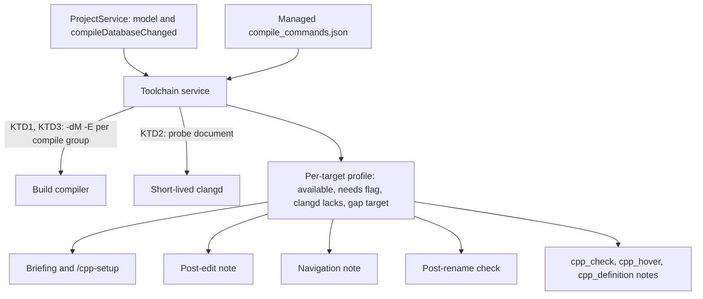
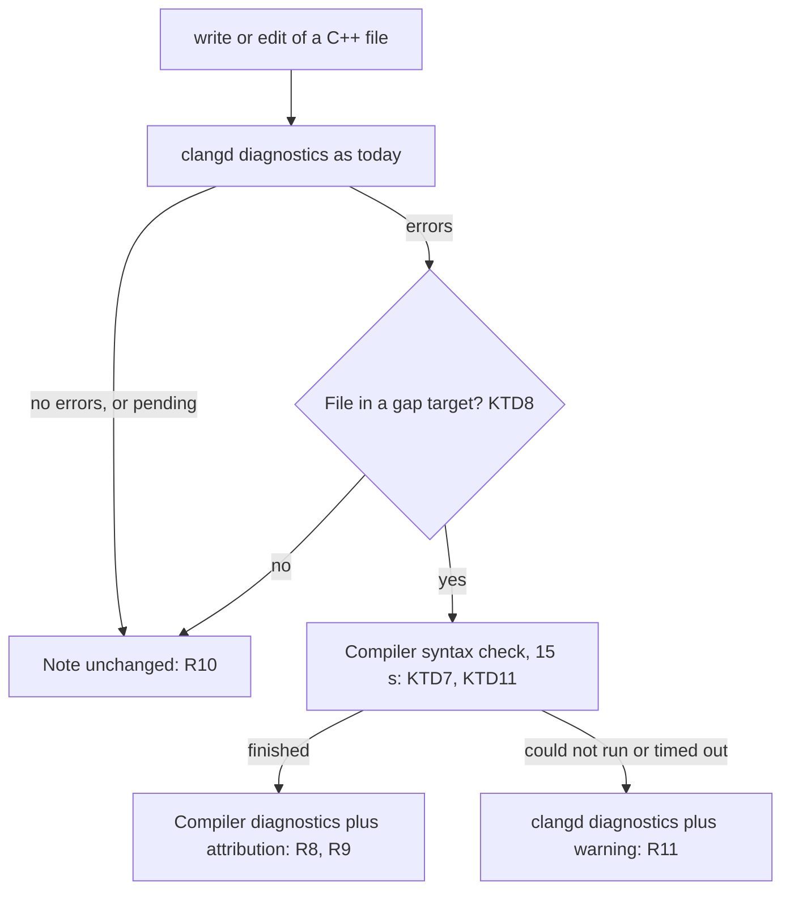

# C++26 Toolchain Gap - Plan

## Goal Capsule

- **Objective:** In a CMake project with C++26 targets, pi knows which C++26 features its toolchain actually accepts, and the extension stops reporting code the build compiler accepts as broken. C++26 idiom guidance and contract-violation reporting are not part of this plan.
- **Means:** A per-session toolchain service. It measures the build compiler with each target's own compile command (KTD1) and clangd with a short-lived probe process (KTD2). It compares the two, and diagnostics, navigation and rename consult the result (KTD6).
- **Product authority:** The Product Contract below owns behavior. On implementation mechanism, the Planning Contract's KTDs win within the cited R constraints. The repo owner decides any scope change.
- **Stop conditions:** Stop and ask if clangd cannot evaluate a probe document under a GCC compile command (KTD2), or if compiling headers on their own produces false errors in the GCC 16 fixture (KTD7). Either would change how R2 or R8 can be met.
- **Execution profile:** One release, delivered as the dependency-ordered units below. Units can land as separate commits on one branch.
- **Open blockers:** None.

---

## Product Contract

### Summary

For each C++26 target, the extension measures which C++26 features the build compiler supports with that target's flags, and which ones clangd supports. The session briefing and `/cpp-setup` report the result, including where clangd is behind. When clangd is behind and reports errors on an edited file, the build compiler re-checks the file and its result replaces clangd's. Navigation results say usages may be missing, and a rename is followed by a compiler check of the targets it affects.

### Problem Frame

C++26 support now differs between compilers. On 2026-11-04, GCC 16.2 compiled a file that uses contracts (`pre`, `post`, `contract_assert`) and static reflection (`^^S`, `std::meta`), with `-freflection`. Clang and clangd 23.1.4 rejected the same file with five or more errors. Clang 23 has no reflection, no contracts, no expansion statements and no constexpr exceptions.

The extension knows each target's standard (it maps `c++2c` to C++26), but not which features the toolchain implements. The briefing tells pi to "write code valid for C++26", and that standard now means different things depending on which compiler builds it. Pi then writes code from incomplete model knowledge of a new standard. It has no way to learn that reflection on GCC 16 needs a flag, or that clangd can't parse the result.

The extension's own feedback is built on clang. The post-edit note, every navigation tool, `cpp_rename` and `cpp_check` all run on clangd or clang-tidy. In a GCC-built project that uses C++26 reflection or contracts, every edit gets clangd errors on code the real build accepts. Pi either chases errors that aren't real or learns to ignore the note. clangd's index also can't parse those files, so references and renames can skip usages inside them without saying so.

---

### Key Decisions

- **This plan covers the gap between the toolchain and clangd: feature detection plus false-error handling.** Feature detection is the base the false-error handling needs. (session-settled: user-approved — chosen over a feature-aware briefing alone, C++26 idiom guidance, or contract-violation parsing: those other areas can follow separately.)
- **Measure feature support. Don't look it up in a version table.** A version table would get GCC 16 wrong, because reflection depends on a per-target flag, not on the compiler version. (session-settled: user-approved — chosen over a compiler/clangd version table or learning only from clangd–compiler disagreements: the table misses flag-gated features, and learning reactively can't feed the briefing.) Governs R1–R4.
- **The build compiler decides whether there are errors after an edit.** (session-settled: user-approved — chosen over labeling clangd's errors as likely false, or hiding them: labels are guesses, and hiding them misses real errors.) Governs R8–R11.
- **Ask the compiler only when clangd reports an error.** Edits that clangd finds clean cost nothing extra. (session-settled: user-approved — chosen over always using the compiler for gap targets, or running both on every edit.) Governs R8, R10.
- **Navigation warns, and rename is followed by a compiler check.** (session-settled: user-approved — chosen over a warning only, or leaving navigation out of scope.) Governs R12–R15.
- **Report a rename that breaks the build. Don't roll it back.** The breakage may have been there before the rename, so rolling back could undo a correct change. Governs R14.
- **Gap detection doesn't depend on which compiler builds the target.** It compares whatever the build compiler supports with whatever clangd supports. So it also covers a clang compiler paired with an older clangd, not only GCC against clangd. Governs R1, R2.

---

<!-- ce-section: work-relationships -->
### How This Work Fits Together

This plan covers the gap between the toolchain and clangd: feature detection and false-error handling. The other areas below are the current understanding, not a committed roadmap.

- C++26 idiom guidance (for C++26 targets, suggest contracts over `assert`, `std::inplace_vector`, saturation arithmetic): Depends on this plan's feature detection (R1–R4), so it suggests only features the toolchain accepts. Still to decide whether it's wanted at all.
- Contract-violation reporting in `cpp_run` and `cpp_test`: Can proceed independently of this plan.
- C++20 modules (`.cppm` and `.ixx` sources, `import std;`, module flags that `cpp_compile` rejects today): Can proceed independently of this plan. It isn't a C++26 feature.

---

### Requirements

A *gap target* is a C++26 target whose build compiler supports at least one listed feature that clangd does not.

**Feature detection**

- R1. For each C++26 target, the extension determines which listed features the target's build compiler supports, using the compiler and flags that target actually compiles with.
- R2. The extension determines which listed features the managed clangd supports.
- R3. The listed features are the C++26 features that have feature-test macros. Language: static reflection, contracts, pack indexing, `#embed`, expansion statements, constexpr exceptions, the `_` placeholder, `= delete("reason")`, structured binding packs, variadic friends and trivial relocatability. Library: the `<meta>` reflection library, `std::inplace_vector`, saturation arithmetic, `std::text_encoding`, `std::hive`, `std::execution`, `std::linalg` and library hardening.
- R4. A feature the compiler offers only behind a flag the target doesn't pass is reported as "needs `<flag>`", not as available. Example: reflection on GCC 16 without `-freflection`.
- R5. Detection results are refreshed whenever a configure changes a target's compiler or flags.

**Briefing and setup**

- R6. The session briefing lists, for each C++26 target, the features it can use, the features that need a flag, and the features clangd lacks. Targets with identical results are grouped.
- R7. `/cpp-setup` shows the listed features for the default C++ compiler and for clangd side by side.

**Post-edit diagnostics**

- R8. When clangd reports at least one error for an edited file in a gap target, the extension syntax-checks the file with the build compiler, and the post-edit note reports the compiler's diagnostics instead of clangd's.
- R9. A note produced under R8 names the compiler that checked the file and the features clangd lacks.
- R10. When clangd reports no errors, or the file is not in a gap target, the post-edit note behaves as it does today.
- R11. When the compiler check under R8 cannot run or doesn't finish in time, the note shows clangd's diagnostics with a warning that errors involving the features clangd lacks may be false.

**Navigation and rename**

- R12. In a project with at least one gap target, results from `cpp_references`, `cpp_symbols`, `cpp_calls` and `cpp_types` end with a note that usages in files that use features clangd lacks may be missing.
- R13. After `cpp_rename` applies its edits in a project with at least one gap target, the extension syntax-checks with the build compiler the sources of the targets that own the changed files and of the targets that depend on them, and reports each error as file and line in the rename result.
- R14. A rename whose compiler check (R13) finds errors stays applied. The result says the build may be broken.
- R15. The compiler check in R13 has a time limit. When the limit is hit, the result names the targets that were not checked.

**Other clang-based tools**

- R16. `cpp_check`, `cpp_hover` and `cpp_definition` on a file in a gap target add a note naming the features clangd or clang-tidy lacks.

---

### Key Flows

- F1. Post-edit check in a gap target
  - **Trigger:** pi writes or edits a C++ file owned by a gap target.
  - **Steps:** clangd diagnoses the file as today. With no errors, the note is unchanged. With errors, the build compiler syntax-checks the file, and its diagnostics replace clangd's in the note, together with the R9 attribution. If the compiler check fails or times out, clangd's diagnostics are shown with the R11 warning.
  - **Covered by:** R8–R11

---

### Acceptance Examples

- AE1. **Covers R8, R9.** Given a target built by GCC 16 with `-std=c++26 -freflection`, when pi edits a file that uses `^^S` and `contract_assert` correctly, clangd reports errors but GCC reports none. The note says the file has no errors, checked by g++ 16, and that clangd lacks reflection and contracts.
- AE2. **Covers R8.** Given the same target, when pi's edit introduces a real type error next to the reflection code, the note shows GCC's error for that line and no clangd errors.
- AE3. **Covers R10.** Given a target built by clang 23 with clangd 23, nothing is a gap, so the post-edit note is clangd's, exactly as today.
- AE4. **Covers R4, R6.** Given a GCC 16 C++26 target without `-freflection`, the briefing lists reflection as "needs `-freflection`" and lists contracts as available.
- AE5. **Covers R13, R14.** Given a gap project where `widget.cpp` uses reflection and calls `old_name()`, and clangd's index missed that call, when pi renames `old_name` to `new_name`, the rename applies. The result reports GCC's error at the `widget.cpp` line that still calls `old_name()` and says the build may be broken.
- AE6. **Covers R10.** Given a GCC target, when pi writes code that uses a feature clang accepts but GCC rejects (trivial relocatability), clangd reports no errors, so no compiler check runs. The briefing (R6) didn't list the feature as available, and the break shows up at `cpp_build`.

---

### Scope Boundaries

- C++26 idiom guidance and contract-violation reporting are separate areas (see How This Work Fits Together).
- Modules, and C++23 or older targets, are out of scope.
- Projects without a CMake project model are out of scope. This includes standalone `cpp_compile`, which keeps its C++17 default.
- `cpp_hover`, `cpp_definition` and `cpp_check` get a note only (R16). They are not rerouted to the compiler.
- Catching the reverse gap after an edit (code clangd accepts that the build compiler rejects) is not covered. The briefing is the only guard (AE6).
- Rolling back a rename that breaks the build is not covered (R14).
- The extension still never edits build files. Adding a flag such as `-freflection` is pi's edit to `CMakeLists.txt`.

---

### Dependencies / Assumptions

- Measured on 2026-11-04 with GCC 16.2.1 and clang/clangd 23.1.4. GCC 16 defines the contracts and expansion-statements macros with plain `-std=c++26`, and the reflection library macro only with `-freflection`. Clang 23 defines neither, and rejects `-fcontracts` as an unknown argument.
- clangd quietly drops GCC-only flags such as `-freflection` and `-fcontracts` from the compilation database (`clangd --check` reported 0 errors on a plain file). So the false errors come from C++26 code, not from flags.
- Detecting features by feature-test macro may under-report a compiler that implements a feature without defining its macro. For example, clang 23 defines no `__cpp_pp_embed`.
- The project model stores only each compile group's language and standard, not its compiler. The compilation database holds the compiler for each file.

---

### Sources / Research

- `extensions/lib/project/model.ts:143` maps standard aliases, including `2c` to `26`. Line 382 records only the language and standard for each compile group.
- `extensions/lib/project/briefing.ts:149` has the "write code valid for the target's standard" guideline. The briefing lists no features.
- `extensions/lib/diagnostics.ts:110` is the post-edit clangd diagnostics. No compiler run feeds the note.
- `extensions/lib/compdb.ts:88-139` runs `cpp_compile`'s syntax check with the compilation database entry's compiler and flags. It doesn't reject `-freflection` or `-fcontracts`.
- `extensions/lib/clangd.ts:99` points the managed clangd at the raw managed `compile_commands.json`, with no flag filtering.
- `extensions/lib/navigation.ts:29-32` holds the existing "results may be incomplete" note while the index builds.
- `extensions/index.ts:31-45` is the `/cpp-setup` check of clangd features by version. `extensions/index.ts:255` runs clang-tidy with `-p`.
- `extensions/lib/rename.ts` runs no compiler check after a rename.
- `docs/plans/2026-11-03-2016-feat-cmake-project-intelligence-plan.md` is the prior plan that set "the extension never edits build files" and the rename refusal rules.

---

## Planning Contract

### Product Contract Preservation

Product Contract unchanged, except that the four "Deferred to Planning" questions are now answered by KTD2 (how clangd is measured), KTD5 (no cross-session cache), KTD11 (time limits) and KTD12 (clang-tidy's features). The Outstanding Questions section was removed because nothing is left open.

### Key Technical Decisions

- KTD1. **Measure the compiler by dumping its macros with the target's own compile command.** Take the compilation database entry of one source per C++26 compile group, swap its source file for a probe that includes `<version>`, and run the same compiler and flags with `-dM -E`. The probe evaluates each catalog entry's condition in the preprocessor and defines a marker macro for every feature that is present. The condition is the feature-test macro at R3's threshold. For `#embed` it is that macro or `defined(__has_embed)`, because clang 19 and newer accept `#embed` without defining `__cpp_pp_embed`. Read the markers, and read `__clang__` / `__GNUC__` to tell the compiler family. Using the real command means flags such as `-freflection`, `-stdlib=libc++` or a cross toolchain count automatically. Governs R1, R3.
- KTD2. **Measure clangd in its own short-lived clangd process, with the same probe turning each present feature's marker into a `#warning`.** The probe sits in a temporary directory, next to a temporary `compile_commands.json` that gives it the same compile command as KTD1. The extension opens it, collects the warnings from the published diagnostics, and closes the process. Before the probe runs, `-w` and any flag that silences `#warning` are removed from its command. clangd has no way to dump its macros, and asking it is the only measurement that matches what clangd actually parses. A clang binary of the same version is not guaranteed to be installed. (session-settled: user-approved — chosen over opening the probe in the session's managed clangd: a separate process cannot disturb the background index or the post-edit connection.) Governs R2.
- KTD3. **Find flag-gated features by probing again with the flag added.** The R3 catalog lists the flag that enables a feature, per compiler family. Today that is one entry: GCC's `-freflection` for reflection and `<meta>`. When the family matches and the macro is missing, KTD1 runs once more with the flag. A feature that appears only then is "needs `-freflection`". A second probe that fails means the compiler does not support the flag: GCC 15 and older reject `-freflection`, and GCC 16 rejects it below C++26. The gated feature then stays missing, and the first probe's result stands. Governs R4.
- KTD4. **Measure one compile command group at a time, and only for C++26 targets.** A C++26 target is one whose `cxxStandard` ranks 26 or newer, so every C++ compile group of the target is C++26 or newer. Groups with the same compiler and flags (ignoring the source file and output flags) share one measurement. A target's profile is the intersection of its groups' results. A target is a gap target when the compiler's available features include something clangd lacks. (session-settled: user-approved — chosen over covering targets that mix C++23 and C++26 sources: mixed targets are rare, and the intersection would hide the C++26 groups anyway.) Governs R1, R6.
- KTD5. **Keep measurements in memory for the session, and measure again when the compilation database changes.** The service listens to `ProjectService.onModelChange` and runs again when `compileDatabaseChanged` is set. Nothing goes to disk. (session-settled: user-approved — chosen over a cache in the managed cache directory: a compiler upgrade would then be hidden behind stale data, and measuring takes about a second.) Governs R5.
- KTD6. **A separate toolchain service owns the measurements, and the other parts read from it.** It sits next to `ManagedClangd`, created once in `extensions/index.ts` and attached to the session's project the way `ManagedClangd.attach` is. `ProjectService` reads it through an optional provider for the briefing. The post-edit pipeline, navigation, rename, `cpp_check`, `cpp_hover` and `cpp_definition` ask it whether a file belongs to a gap target. If measurement has not finished when the first briefing goes out, the feature section arrives once in the next run's update message. (session-settled: user-approved — chosen over holding the briefing until measurement finishes: the briefing is not delayed.) Governs R6, R8, R12, R13, R16.
- KTD7. **The compiler check reuses `cpp_compile`'s invocation for sources and compiles headers on their own.** A source with a database entry goes through `resolveCompileInvocation`, the same path `cpp_compile` uses. A header has no entry, so it borrows its profile's compile command, with the header as input, `-x c++` and the "pragma once in main file" warning switched off. (session-settled: user-approved — chosen over skipping the compiler for headers: reflection code usually lives in headers, and leaving them out would keep most of the false errors.) Governs R8.
- KTD8. **A header no target lists belongs to the C++26 target whose include directories contain it.** The first matching gap target wins. When none matches, the file is not in a gap target, so R10 applies. (session-settled: user-approved — chosen over treating every unowned header as gap: in a mixed project that would send clean clang targets' headers to the wrong compiler.) Governs R8, R10.
- KTD9. **Read the compiler's plain-text diagnostics.** For GCC, add `-fdiagnostics-plain-output`. For clang, add `-fno-color-diagnostics -fno-caret-diagnostics`. Keep the `path:line:col: error|warning: message` lines and drop notes and context lines. Render them in the post-edit note's existing format: errors first, at most 20. GCC's SARIF or JSON formats would mean a second output parser for one consumer. Governs R8, R9.
- KTD10. **The post-rename check compiles only gap targets.** The affected targets are the owners of the changed files plus every target that depends on them, directly or indirectly. Of those, only gap targets are checked, because clangd indexed the others fully. A changed header with no owner makes every gap target affected. Up to four compiles run at once. (session-settled: user-approved — chosen over checking every affected target: non-gap targets cannot hold usages clangd missed.) Governs R13.
- KTD11. **Time limits: 15 seconds for the post-edit compiler check and 60 seconds for the whole post-rename check.** 15 seconds is half of `cpp_compile`'s 30-second timeout, because the check runs inside every erroring edit. A post-rename check that hits its limit lists the targets it did not reach. (session-settled: user-approved — proposed in the plan synthesis and confirmed.) Governs R11, R15.
- KTD12. **The notes for clang-tidy, hover and definition name clangd's missing features.** clang-tidy usually comes from the same LLVM install as clangd, so measuring it separately would double the probe cost for a note. The note says "clang-based tools", not "clangd". Governs R16.
- KTD14. **Strip CMake's module-scanning arguments before the existing flag filter runs.** CMake 3.28 and newer, with Ninja and a C++20-or-newer target, add `-fmodules-ts`, `-fmodule-mapper=…`, `-fdeps-format=…` and related `-fdeps-*` flags for GCC, or an `@….modmap` response file for clang, to every compilation database entry. `syntaxArguments` rejects both forms, so without this every C++26 measurement and compiler check would fail. The stripping goes into `syntaxArguments`, so `cpp_compile` gains it too. A source that really uses `import` still fails its check, because modules stay out of scope. Governs R1, R8, R13.
- KTD13. **Tests use fake compiler output and an extended mock clangd. Real-toolchain tests run only where `g++` accepts `-std=c++26 -freflection`.** The mock clangd learns to answer probe documents with warnings for a feature list the test sets. CI keeps Ubuntu 24.04's GCC 13, so it runs the fake-output tests and skips the real-GCC ones. (session-settled: user-approved — chosen over adding GCC 16 to CI: no maintained GCC 16 package exists for the runner, and the fake-output tests cover the logic.)

### High-Level Technical Design

How the measurements flow to the tools that use them:

The post-edit decision (F1, R8–R11):

### System-Wide Impact

- **`cpp_compile` accepts CMake module-scanning flags.** KTD14 changes the shared flag filter, so `cpp_compile` no longer refuses compilation database entries from CMake 3.28+ Ninja builds of C++20-or-newer targets.
- **Executes the project's compiler more often.** Measurement and the compiler checks run the compiler from the project's compilation database. They only run when a project model exists, which requires pi to trust the project, the same condition as configure. They do not add a new trust surface beyond what `cpp_compile` already does.
- **Nothing is written into the project tree.** Probe files and the probe's `compile_commands.json` live in a temporary directory that is removed after each measurement.
- **Briefing size.** The feature section counts toward `BRIEFING_BUDGET`. In the summary form, targets with identical profiles collapse into one line.
- **Post-edit latency.** Only edits that clangd reports as erroring, in gap targets, pay the extra compile.

### Risks & Dependencies

- **A header compiled on its own may not be self-contained.** Such a header gets compiler errors that aren't real (KTD7). Mitigation: the attribution line (R9) names the check, so pi can see the source of the errors. The GCC 16 fixture test (U5) proves a self-contained header compiles clean.
- **Under-reported macros.** A compiler may implement a feature without defining its macro. When only one side defines the macro, the other side looks behind, which creates a false gap. `#embed` is the known case today: GCC 16 defines `__cpp_pp_embed` and clang 23 does not. KTD1's `__has_embed` condition covers it. A future case of the same kind gets its own catalog condition.
- **Probe warnings suppressed by project flags.** KTD2 strips the known flags. Any other suppression shows up as "clangd lacks everything", which would wrongly mark targets as gap targets. The U2 tests cover `-w` and `-Werror`.
- **clangd started with GCC driver flags.** We verified that clangd 23 ignores `-freflection` and `-fcontracts`. Older clangd versions may report unknown arguments as diagnostics. The probe reads only its own marker warnings, so this does not change its result.

### Deferred to Implementation

- The exact names of the toolchain service, its provider interface and the probe marker format.
- Whether the probe source builder lives in `extensions/lib/toolchain.ts` or a smaller helper module.
- The wording of the briefing section, within R6 and the existing briefing style.

---

## Implementation Units

### U1. Feature catalog and compiler measurement

**Goal:** Know which listed C++26 features a compile command supports, including flag-gated ones.

**Requirements:** R1, R3, R4

**Dependencies:** None

**Files:**

- Create: `extensions/lib/toolchain.ts` (catalog, macro parsing, compiler measurement)
- Modify: `extensions/lib/compdb.ts` (strip module-scanning arguments in `syntaxArguments` per KTD14; load the database once into a per-file map; build probe arguments from an entry)
- Test: `tests/toolchain.test.ts`, `tests/compdb.test.ts`

**Approach:**

1. Catalog: one entry per R3 feature, with its detection condition, language or library kind, and the enabling flag per family (KTD1, KTD3).
2. Probe source: include `<version>`, then define one marker macro per feature whose condition holds (KTD1).
3. Probe arguments: start from the entry's argv, apply `syntaxArguments`' filtering (including KTD14), drop the source file and output flags, and add `-dM -E` and the probe path.
4. Run the probe through `Exec` with a short timeout. Read the marker macros and the family macros from the dump.
5. For a matching family with a missing gated feature, probe once more with the flag added. A failing second probe leaves the first result in place (KTD3).

**Patterns to follow:** `syntaxArguments` and `checkCompiler` in `extensions/lib/compdb.ts`. The `Exec` injection in `extensions/lib/project/configure.ts`.

**Test scenarios:**

- A GCC 16 macro dump with `__cpp_contracts 202502L` and no `__cpp_lib_reflection` reports contracts available and reflection missing.
- With the second GCC probe returning `__cpp_lib_reflection`, reflection is reported as "needs `-freflection`". Covers AE4.
- A clang dump with `__clang__` gets no second probe, even when reflection is missing.
- A macro below the catalog's minimum value counts as missing.
- A dump without `__cpp_pp_embed` but with the `#embed` marker set through `__has_embed` reports `#embed` present.
- An entry whose compiler fails `checkCompiler`, or a first probe that exits non-zero, gives a "could not measure" result with the reason, not an exception.
- A GCC first probe succeeds and the `-freflection` second probe exits non-zero, as GCC 15 does. Reflection is reported missing and every other feature keeps the first probe's result.
- Probe arguments keep `-I`, `-D`, `-std` and `-freflection`, and drop `-c`, `-o`, the source file and dependency-file flags.
- A CMake 3.28+ Ninja GCC entry with `-fmodules-ts -fmodule-mapper=… -fdeps-format=p1689r5`, and a clang entry with an `@….modmap` argument, both produce probe arguments without those flags. `syntaxArguments` (and so `cpp_compile`) accepts both entries.

**Verification:** The catalog and compiler measurement give the expected profile for recorded GCC 16 and clang 23 macro dumps.

### U2. clangd measurement

**Goal:** Know which listed features clangd supports under the same compile command.

**Requirements:** R2

**Dependencies:** U1

**Files:**

- Modify: `extensions/lib/toolchain.ts` (probe document builder and clangd measurement)
- Modify: `tests/fixtures/mock-clangd.mjs` (answer probe documents with warnings for a feature list the test passes)
- Test: `tests/toolchain.test.ts`

**Approach:**

1. Write the probe source and a one-entry `compile_commands.json` to a fresh temporary directory, with the group's command minus warning suppressors (KTD2).
2. Start a `ClangdConnection` on that directory, sync the probe, and wait for its diagnostics with a bound.
3. Map marker warnings back to catalog features. Close the connection and remove the directory whatever happens.

**Patterns to follow:** `ClangdConnection.syncFile` and `waitForDiagnostics` in `extensions/lib/clangd.ts`. The mock-clangd marker approach (`DIAG`, `INDEX-BEGIN`).

**Test scenarios:**

- With the mock set to report pack indexing and placeholder variables, the clangd profile holds exactly those.
- A group command with `-w` and `-Werror` still yields the mock's feature list, because both are stripped.
- clangd missing from PATH, or diagnostics never arriving within the bound, gives "could not measure clangd", and the temporary directory is gone afterwards.
- Integration, only when local `clangd` is 23 or newer: real clangd under a `g++ -std=c++26 -freflection` command reports no reflection and no contracts, and does report pack indexing and `#embed`.

**Verification:** The probe process never outlives a measurement, and no files remain in the temporary area.

### U3. Toolchain service

**Goal:** Per-session profiles for each C++26 target, kept current with the project model, and answers to "is this file in a gap target?".

**Requirements:** R1, R2, R5, R8 (ownership), R10

**Dependencies:** U1, U2

**Files:**

- Modify: `extensions/lib/toolchain.ts` (the service)
- Modify: `extensions/index.ts` (create the service, attach it at session start, release it at shutdown)
- Test: `tests/toolchain.test.ts`

**Approach:**

1. On a model change with `compileDatabaseChanged`, or the first model, select C++26 targets (KTD4). Group their sources' database entries by command and measure each group with U1 and U2, at most two groups at a time.
2. Build per-target profiles and the gap-target set. Expose a ready promise, the current profiles, and a lookup for a file's gap profile that applies KTD8 to unowned headers.
3. A newer model cancels an older measurement in flight (KTD5).

**Patterns to follow:** `ManagedClangd.attach`, its generation counter and `onModelChange` handling in `extensions/lib/clangd.ts`. `ownersOf` and `effectiveStandard` in `extensions/lib/project/model.ts`.

**Test scenarios:**

- A model with a C++26 GCC target and a C++20 target measures only the C++26 one.
- Two targets with identical commands share one measurement, so the fake `Exec` sees one probe per command.
- A target with two C++26 groups gets the intersection of the two results.
- A GCC 16 profile and a clangd profile that both report `#embed` (one by macro, one by `__has_embed`) do not make the target a gap target for `#embed`.
- A model change without `compileDatabaseChanged` does not measure again. One with it does.
- An unowned header under a gap target's include directory resolves to that target. A header outside every include directory resolves to no gap.
- A model change during a measurement leaves only the newer result.

**Verification:** Profiles match the fixture models, and stale measurements never overwrite newer ones.

### U4. Briefing and `/cpp-setup`

**Goal:** pi and the user see the feature profile.

**Requirements:** R6, R7

**Dependencies:** U3

**Files:**

- Modify: `extensions/lib/project/briefing.ts` (feature section in the full and summary forms)
- Modify: `extensions/lib/project/session.ts` (optional toolchain provider; one-time late-arrival update per KTD6)
- Modify: `extensions/index.ts` (`/cpp-setup` measures the default compiler and clangd)
- Test: `tests/briefing.test.ts`, `tests/project-session.test.ts`, `tests/extension.test.ts`

**Approach:**

1. The briefing gains a "C++26 features" section for C++26 targets, grouping targets with identical profiles: available features, features that need a flag, and features clangd lacks.
2. If the provider is not ready when the briefing is rendered, the section says the check is running, and the next `runMessage` carries the section once as an update.
3. `/cpp-setup` measures `$CXX` or else `c++` with `-std=c++26`, and clangd with the same command, using U1 and U2 directly. It then prints the two lists side by side.

**Patterns to follow:** `full` and `summary` in `extensions/lib/project/briefing.ts`. `modelChangeLines` and `runMessage` in `extensions/lib/project/session.ts`. `clangdFeatures` and `cmakeFeatures` in `extensions/index.ts`.

**Test scenarios:**

- Covers AE4. A GCC 16 target without `-freflection` shows reflection under "needs `-freflection`" and contracts under available.
- Two targets with the same profile appear on one line.
- With no C++26 targets, the section is absent.
- A briefing rendered before the provider is ready says the check is running, and the next run message carries the section exactly once.
- The summary form still fits `BRIEFING_BUDGET` with ten C++26 targets in three distinct profiles.
- `/cpp-setup` with a fake compiler and the mock clangd prints both feature lists. With no `c++` on PATH it says so instead of failing.

**Verification:** A session on a C++26 fixture shows the feature section in the first briefing or in the first update after it.

### U5. Post-edit compiler check

**Goal:** In gap targets, the post-edit note reports the build compiler's verdict when clangd reports errors.

**Requirements:** R8, R9, R10, R11, F1

**Dependencies:** U3

**Files:**

- Modify: `extensions/lib/diagnostics.ts` (error count from `diagnose`; compiler check; output parsing; attribution and fallback lines)
- Modify: `extensions/index.ts` (pass the toolchain service into the post-edit options)
- Create: `tests/fixtures/cmake/cxx26/` (C++26 target with a reflection and contracts source and a self-contained reflection header, for the gated real-GCC test). It uses `cmake_minimum_required(VERSION 3.28)` so its compilation database carries the module-scanning flags KTD14 strips.
- Test: `tests/diagnostics.test.ts`

**Approach:**

1. `diagnose` reports how many errors clangd found, next to its lines.
2. When that is above zero and the file has a gap profile, run the compiler check (KTD7, KTD9) with the 15-second limit (KTD11).
3. On success, replace clangd's lines with the compiler's lines plus the R9 attribution. On failure or timeout, keep clangd's lines and add the R11 warning.

**Patterns to follow:** `within` and `renderDiagnostics` in `extensions/lib/diagnostics.ts`. `resolveCompileInvocation` in `extensions/lib/compdb.ts`. The fake `Exec` helpers at the top of `tests/diagnostics.test.ts`.

**Test scenarios:**

- Covers AE1. Mock clangd reports an error (`DIAG`), the file is in a gap target, and the fake compiler exits 0. The note says there are no problems and names the compiler and the features clangd lacks.
- Covers AE2. The fake compiler prints one `error:` line. The note shows that error at its line and no clangd lines.
- Covers AE3. The file is in a non-gap target with a clangd error. The note is clangd's, unchanged, and the compiler is not run.
- A clean clangd result in a gap target does not run the compiler.
- The fake compiler hangs past the limit. The note shows clangd's error plus the R11 warning.
- An edited header in a gap target is compiled with the borrowed command, `-x c++` and the header path.
- Compiler output with notes, caret lines and `In file included from` lines yields only the error and warning lines.
- Integration, only when `g++` accepts `-std=c++26 -freflection`: editing the fixture's reflection source and its header gives "no problems" attributed to g++, while clangd alone reports errors.

**Verification:** For edits clangd finds clean, the post-edit note is the same as today. In gap targets, clangd's false errors never reach the note when the compiler check finishes.

### U6. Navigation and clang-based tool notes

**Goal:** Results that may miss usages, or that come from clang-based analysis, say so in projects with gap targets.

**Requirements:** R12, R16

**Dependencies:** U3

**Files:**

- Modify: `extensions/lib/navigation.ts` (gap note after the index note)
- Modify: `extensions/lib/clangd.ts` (note on `cpp_hover` and `cpp_definition` for files in gap targets)
- Modify: `extensions/index.ts` (note on `cpp_check` for files in gap targets; wire the provider into navigation and clangd tools)
- Test: `tests/navigation.test.ts`, `tests/clangd.test.ts`, `tests/extension.test.ts`

**Approach:** Navigation tools take an optional provider and add one line naming the features clangd lacks when any gap target exists. The other three tools add the KTD12 line only for a file with a gap profile.

**Patterns to follow:** `indexNote` and the `registerNavigationTools` options in `extensions/lib/navigation.ts`.

**Test scenarios:**

- `cpp_references` in a project with a gap target ends with the gap note naming reflection and contracts.
- Without gap targets, navigation output is byte-identical to today.
- The index-building note and the gap note both appear, each on its own line.
- `cpp_hover` on a file in a gap target carries the note. On a file in a non-gap target it does not.
- `cpp_check` on a file in a gap target carries the note after the tool output.

**Verification:** Output changes only in projects with gap targets.

### U7. Post-rename compiler check

**Goal:** A rename in a project with gap targets reports build breakage clangd could not see.

**Requirements:** R13, R14, R15

**Dependencies:** U3, U5 (shared compiler-check and output-parsing helpers)

**Files:**

- Modify: `extensions/lib/rename.ts` (affected-target selection, bounded concurrent checks, result lines)
- Modify: `extensions/lib/project/model.ts` (reverse dependency closure helper, if not already derivable)
- Test: `tests/rename.test.ts`

**Approach:**

1. Step 6 calls the post-edit pipeline without the toolchain service, so changed files get clangd's lines but no per-file compiler check. This keeps the rename inside KTD11's 60-second bound and avoids compiling the same file twice.
2. When gap targets exist, compute the affected gap targets per KTD10.
3. Syntax-check their C++ sources with up to four at once, within 60 seconds (KTD11).
4. For each changed file in a gap target, replace its clangd lines with that file's compiler lines and the R9 attribution. A changed file the check did not reach keeps clangd's lines with the R11 warning.
5. Append the errors in other files (capped as in KTD9, with a count of any omitted), a "the build may be broken" line when any exist, and the unreached targets on timeout. Never roll back (R14).

**Patterns to follow:** step 6 of `registerRenameTool` in `extensions/lib/rename.ts`. Target `dependencies` in `extensions/lib/project/model.ts`.

**Test scenarios:**

- Covers AE5. The fake compiler reports an error for `widget.cpp` in a gap target. The rename stays applied, and the result lists `widget.cpp`'s error line and says the build may be broken.
- A rename touching only a non-gap target, in a project whose gap target depends on it, checks the gap target's sources.
- A rename in a project without gap targets runs no compiler.
- The fake compiler is slow enough to exceed the 60-second limit, simulated with a short limit in the test. The result names the unchecked targets.
- A changed header with no owner marks every gap target affected.
- A rename that changes two reflection files in a gap target runs the compiler once per file, inside the post-rename check. Each file's entry shows the compiler's lines with the R9 attribution, not clangd's errors.

**Verification:** The rename result is unchanged outside projects with gap targets. Inside them, compiler errors are listed up to the KTD9 cap of 20, with a count of any omitted, and no file is compiled twice.

### U8. Documentation

**Goal:** Users can find out what the feature profile means and what changes in C++26 projects.

**Requirements:** R6, R7, R8, R12, R13, R16

**Dependencies:** U4, U5, U6, U7

**Files:**

- Modify: `README.md` (C++26 feature section, post-edit compiler check, version-requirements row)
- Modify: `CHANGELOG.md` (Unreleased entries)
- Modify: `skills/cpp-setup/SKILL.md` (`/cpp-setup` now lists C++26 features)

**Approach:** Describe behavior in the README's existing plain style. Name GCC 16 with `-freflection` as the case where clangd is behind.

**Test expectation:** none -- documentation only; markdownlint covers it.

**Verification:** The README and CHANGELOG describe every user-visible change in R6–R16, and markdownlint passes.

---

## Verification Contract

| Gate | Command | Applies to |
|---|---|---|
| Type check | `npm run typecheck` | All units |
| Tests | `npm test` | All units; real-GCC tests skip unless `g++` accepts `-std=c++26 -freflection`, real-clangd tests skip without clangd |
| Markdown lint | `npx markdownlint-cli2 "**/*.md"` | U8 and this plan |
| Package contents | `npm pack --dry-run` | U1; confirm `extensions/lib/toolchain.ts` ships |
| Manual smoke | `pi -e ./` on `tests/fixtures/cmake/cxx26` configured with GCC 16: the briefing lists features, editing the reflection source gives a compiler-attributed note, `cpp_references` carries the gap note | U4, U5, U6 |

---

## Definition of Done

- Every unit's verification holds, and AE1–AE5 are each covered by a passing test. AE6 holds by construction, since no compiler check runs on a clean clangd result (U5 scenario).
- `npm run typecheck`, `npm test` and markdownlint pass locally and in CI.
- On a machine with GCC 16, the gated real-toolchain tests run and pass.
- No probe file, temporary `compile_commands.json` or clangd probe process remains after the test suite, and fixture trees are unchanged.
- Projects without C++26 targets see byte-identical briefing, post-edit, navigation and rename output.
- No dead-end or experimental code from abandoned approaches remains in the diff.
