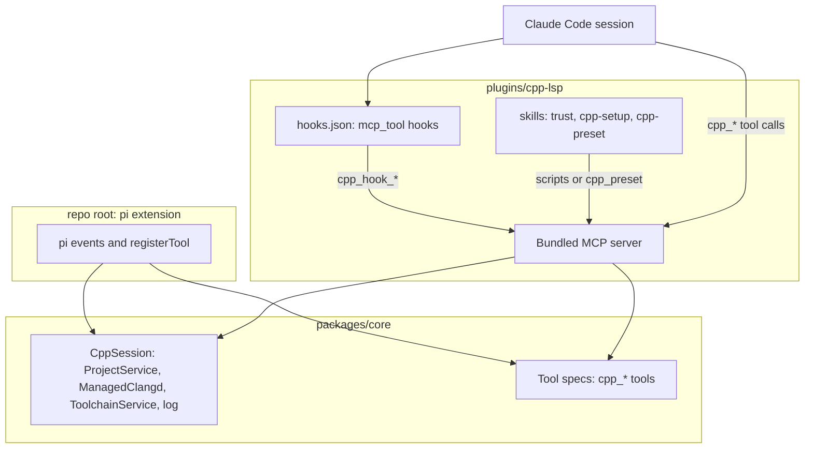

# Claude Code Plugin - Plan

## Goal Capsule

- **Objective:** When you work on a C++ CMake project in Claude Code, Claude Code gets the same help pi gets from pi-cpp-lsp 2.0.0: a project briefing, post-edit notes, the C++ tools and the compiler check when clangd is behind. Other harnesses (Codex CLI, opencode) are not part of this plan.
- **Means:** The pi extension's C++ logic moves into a shared core package in this repo (KTD1, KTD2). A Claude Code plugin wraps that core with one MCP server per session, hooks that call it, and skills for the commands (KTD4–KTD7).
- **Product authority:** The Product Contract below owns behavior. On implementation mechanism, the Planning Contract's KTDs win within the cited R constraints. The repo owner decides any scope change.
- **Stop conditions:** Stop and ask if the U3 spike shows any of these: an `mcp_tool` hook cannot return `additionalContext` from the plugin's MCP server (KTD5); the server process does not live across hook calls in one session; or a `SessionStart` `mcp_tool` hook does not fire after `/clear` or `/compact` (KTD6). Each would change the plugin's shape.
- **Execution profile:** One release of the plugin, delivered as the dependency-ordered units below. pi-cpp-lsp gets a patch release only if its published files change. Units land as separate commits on one branch.
- **Open blockers:** None.

---

## Product Contract

### Summary

The repo becomes a workspace with three packages: a shared C++ core, the pi extension, and a Claude Code plugin named `cpp-lsp`. The pi extension keeps its npm name and its 2.0.0 behavior. The Claude Code plugin is installed from this repo as a marketplace. Its MCP server holds the CMake model, the managed clangd and the toolchain detection for the session, and its hooks and skills bring pi's briefing, post-edit notes and commands to Claude Code.

### Problem Frame

The repo owner uses Claude Code on their own C++ projects, and Claude Code has none of what pi-cpp-lsp gives pi. It starts coding without knowing which targets exist or which C++ standard each uses. It searches with grep instead of a clangd index. It doesn't notice source files that no `CMakeLists.txt` registers. In projects built with a compiler newer than clangd, nothing checks clangd's false errors.

All of that logic already exists, but only behind pi's extension API. `extensions/index.ts` registers eleven tools and five event handlers on pi, and several `lib/` modules take pi's `ExtensionAPI` directly. No other harness can use it as it stands.

Claude Code can host the same experience. Its plugins bundle MCP servers, hooks and skills. Hooks can call the plugin's own MCP server, and a hook's output can add text next to a tool result or a prompt.

---

### Key Decisions

- **This plan covers the shared core plus Claude Code; each other harness gets its own later plan.** Claude Code's documented plugin features can carry the full experience, and the core is only worth extracting together with a first harness that proves where it splits. (session-settled: user-approved — chosen over Codex CLI first, opencode first, or every harness at once: Codex details came only from community sources, opencode reportedly can't add text to the model's context from hooks, and all at once is hard to verify end to end.)
- **The first Claude Code version matches pi-cpp-lsp 2.0.0 in full.** Anything Claude Code can't do is detected and logged, following the project's rule: feature-detect, do what's possible, log what isn't, and never repeat notes on every result. (session-settled: user-approved — chosen over tools only, or tools plus post-edit note.) Governs R5–R16.
- **One repo with workspace packages, and the repo is also the Claude Code marketplace.** Existing pi installs keep working because the pi package keeps the `pi-cpp-lsp` npm name. (session-settled: user-approved — chosen over renaming the repo to a neutral name, or a separate plugin repo.) Governs R1–R4.
- **The plugin uses its own per-project opt-in instead of Claude Code's trust.** Configuring runs the project's CMake code, and Claude Code documents no trust signal for installed plugins. (session-settled: user-approved — chosen over relying on Claude Code's workspace trust, or always running.) Governs R17–R19.
- **The plugin runs its own managed clangd and registers no LSP server with Claude Code.** That keeps the managed compile database, background index, rename transaction and compiler check. (session-settled: user-approved — chosen over also registering clangd through `.lsp.json`, or relying only on Claude Code's LSP and the official `clangd-lsp` plugin.) Governs R20.
- **All session state lives in the plugin's MCP server, and every hook calls it.** The hooks need what the server holds (the CMake model, clangd, detection results), and the docs offer `mcp_tool` hooks for exactly that. A second process or a file-based handoff would hold that state twice. Governs R7–R12.
- **The Claude Code plugin keeps its own managed cache, separate from pi's.** If both harnesses are used on one project, each configures it once rather than sharing a build directory and racing on it. Governs R21.

---

<!-- ce-section: work-relationships -->
### How This Work Fits Together

This plan covers the shared core and the Claude Code plugin. The other areas below are the current understanding, not a committed roadmap.

- pi extension: Depends on the shared core after this plan. Its behavior stays as in 2.0.0 (R3).
- Codex CLI package: Depends on the shared core. Still to decide once Codex's skills, hooks and plugin manifest are verified against official docs.
- opencode package: Depends on the shared core. Still to decide; its hooks reportedly can't add text to the model's context yet (opencode issue #17412), which affects the post-edit note.

---

### Requirements

**Repository and packages**

- R1. The repo holds three workspace packages: the shared C++ core, the pi extension and the Claude Code plugin.
- R2. The shared core contains everything harness-independent: the CMake project model and drift, the managed clangd and navigation, rename, the build and test runners, C++ feature detection, the compiler check and the project log. It has no dependency on pi or on Claude Code.
- R3. The pi extension keeps the npm name `pi-cpp-lsp`, and its tools, notes, briefing and commands behave as in 2.0.0.
- R4. The repo is a Claude Code plugin marketplace, so the plugin installs with `claude plugin marketplace add martin-juul/pi-cpp-lsp` and `claude plugin install cpp-lsp@<marketplace>`.

**Claude Code plugin: tools and session state**

- R5. The plugin offers every `cpp_*` tool pi-cpp-lsp 2.0.0 offers, with the same parameters and results.
- R6. One plugin MCP server process per Claude Code session holds the project state: CMake root discovery and the managed configure, the project model, the managed clangd with its background index, the toolchain profiles and the project log.

**Claude Code plugin: briefing and notes**

- R7. The first prompt of a session in an enabled CMake project carries the project briefing, as pi's first prompt does, including the C++ features section.
- R8. After a compaction, the next prompt carries the briefing again.
- R9. Later prompts carry only what changed (configure results, model changes, the one-time feature update), as pi's update messages do.
- R10. After a Write or Edit of a C/C++ file, Claude Code receives the post-edit note pi produces: the clang-format result, drift, the owning targets and their standard, and diagnostics, with the build compiler's verdict when clangd is behind.
- R11. After a Bash command, Claude Code receives the drift note pi produces after `bash`.
- R12. All notes reach the model next to the tool result or prompt they belong to, never as a separate message the user has to read.

**Claude Code plugin: commands**

- R13. `/cpp-lsp:cpp-setup` reports what pi's `/cpp-setup` reports: toolchain availability, navigation features by clangd version, CMake thresholds, and the C++ feature comparison of the default compiler and clangd.
- R14. `/cpp-lsp:cpp-preset` lists the configure presets, and `/cpp-lsp:cpp-preset <name>` switches the project to that preset and reconfigures.
- R15. `/cpp-lsp:trust` enables the plugin for the current CMake project (R17).
- R16. Anything the plugin can't do in Claude Code is detected and written to the project log, not repeated in results.

**Trust**

- R17. In a CMake project the user has not enabled, the plugin runs no CMake, no compiler and no managed clangd. Its tools say the project needs `/cpp-lsp:trust`.
- R18. In such a project, the first prompt of a session carries one line saying the plugin is inactive there and how to enable it. Later prompts don't repeat it.
- R19. Enabled projects are remembered across sessions in the plugin's data directory, so a project is enabled once.

**Coexistence**

- R20. The plugin registers no LSP server with Claude Code. If the official `clangd-lsp` plugin is enabled at the same time, the plugin writes once to the project log that Claude Code's own clangd diagnostics bypass the compiler check, and changes nothing else.
- R21. The plugin's managed build directories, clangd index, remembered preset and log live in its own cache, separate from pi's, and never in the project tree.

---

### Acceptance Examples

- AE1. **Covers R7, R10.** Given an enabled CMake project, when the user sends the first prompt, Claude Code's context includes the briefing with targets, standards and C++ features. When Claude then edits `src/main.cpp`, the Edit result is followed by the post-edit note with format, owner and diagnostics.
- AE2. **Covers R17, R18.** Given a CMake project the user has never enabled, the first prompt carries one line naming `/cpp-lsp:trust`, no CMake runs, and a call to `cpp_references` returns that the project needs `/cpp-lsp:trust`. The second prompt carries no such line.
- AE3. **Covers R15, R19.** Given the user runs `/cpp-lsp:trust` in a project, the plugin configures it and the next prompt carries the briefing. In a new session in the same project, the briefing arrives without running `/cpp-lsp:trust` again.
- AE4. **Covers R10.** Given an enabled project with a GCC 16 C++26 target using reflection, when Claude edits a file clangd reports errors for, the post-edit note shows the build compiler's verdict and "checked by g++ 16", as in pi.
- AE5. **Covers R20.** Given the official `clangd-lsp` plugin is also enabled, nothing is added to results. The project log has one entry saying Claude Code's own clangd diagnostics bypass the compiler check.
- AE6. **Covers R3.** Given the pi extension built on the shared core, the pi-cpp-lsp 2.0.0 test suite passes unchanged in what it asserts.

---

### Scope Boundaries

- Codex CLI, opencode, Cursor and other harnesses. Each gets its own plan on top of the shared core (see How This Work Fits Together).
- Any change to pi-cpp-lsp's behavior (R3).
- Registering clangd with Claude Code's LSP support (R20).
- Publishing the plugin to Anthropic's or any third-party marketplace. This repo is the marketplace.
- Sharing one managed build directory between pi and Claude Code (R21).

---

### Dependencies / Assumptions

- Claude Code facts come from its official docs, fetched 2026-11-04:
  - Plugins bundle skills, hooks, MCP servers and LSP servers.
  - `mcp_tool` hooks call a plugin's MCP server by its scoped name `plugin:<plugin>:<server>`.
  - `hookSpecificOutput.additionalContext` from PostToolUse and UserPromptSubmit hooks is placed next to the tool result or prompt.
  - `mcp_tool` hooks are skipped on the startup SessionStart because MCP servers aren't connected yet.
  - SessionStart has a `compact` source.
  - `${CLAUDE_PLUGIN_DATA}` survives plugin updates.
  - Claude Code installs a plugin's npm dependencies only from a `package-lock.json` at the plugin root.
- Assumed, not yet verified: one plugin MCP server process lives for the whole session (the docs imply it but don't say it), and a hook added at SessionStart with source `compact` can re-send the briefing.
- The docs give installed plugins no signal about workspace trust, which is why R17–R19 add an opt-in.

---

### Sources / Research

- Claude Code docs: [plugin components](https://code.claude.com/docs/en/plugins/components.md), [manifest reference](https://code.claude.com/docs/en/plugins/manifest-reference.md), [hooks](https://code.claude.com/docs/en/hooks.md), [MCP](https://code.claude.com/docs/en/mcp.md), [plugin loading and trust](https://code.claude.com/docs/en/plugins/loading.md), [code intelligence (LSP)](https://code.claude.com/docs/en/plugins/code-intelligence.md), [skills](https://code.claude.com/docs/en/skills.md), [marketplaces](https://code.claude.com/docs/en/plugins/create-marketplace.md).
- `extensions/index.ts` holds the pi wiring and four tools of its own (`cpp_check`, `cpp_compile`, `cpp_format`, `cpp_gen_compdb`) that use pi's runtime `truncateHead`; overall eleven `pi.registerTool` calls; `pi.on` for `session_start`, `before_agent_start`, `tool_result`, `session_compact` and `session_shutdown`; `ctx.ui.notify`; `ctx.isProjectTrusted`.
- `extensions/lib/build.ts`, `clangd.ts`, `navigation.ts`, `rename.ts`, `project/configure.ts` and `project/tools.ts` import pi's API types; the rest of `lib/` doesn't.
- `docs/plans/2026-11-03-2016-feat-cmake-project-intelligence-plan.md` and `docs/plans/2026-11-04-2054-feat-cpp26-toolchain-gap-plan.md` define the behavior this plan ports.

---

## Planning Contract

### Product Contract Preservation

Product Contract unchanged, except that the five "Deferred to Planning" questions are now answered by KTD5 (the `mcp_tool` hook result), KTD6 (the edit-tool matcher and the compaction path), KTD3 (bundled server) and KTD9 (detecting `clangd-lsp`). The Outstanding Questions section was removed.

### Key Technical Decisions

- KTD1. **The pi extension stays at the repo root; the core moves to `packages/core`, and pi imports it by relative path.** pi installs a git source by cloning the repo and reading the root `package.json`'s `pi` manifest, and the README advertises `pi install git:github.com/martin-juul/pi-cpp-lsp`. A relative import also keeps `npm:pi-cpp-lsp` self-contained: the root package's `files` lists `packages/core/src`, so the tarball needs no second published package. npm workspaces (`packages/core`, `plugins/cpp-lsp`) give the core and the plugin their own manifests and scripts. Governs R1–R3.
- KTD2. **The core speaks in harness-neutral tool specs and a session facade.** A tool spec is a name, description, prompt snippet and guidelines, a TypeBox parameter schema, and an `execute(params, context)` that returns text, details and an error flag. A `CppSession` facade owns one session's `ProjectService`, `ManagedClangd`, `ToolchainService` and log, and offers `promptMessage()`, `postEditNote(file)`, `afterShell()`, `compacted()` and `dispose()`. The core defines its own `Exec` type instead of pi's `ExecOptions`/`ExecResult`, and its own head truncation for long tool output, matching pi's `truncateHead` (2000 lines, 50 KB) and size text. The untrusted reason and the enable steps are session options, so pi keeps its 2.0.0 wording and the plugin names `/cpp-lsp:trust`. The pi adapter maps pi events and `registerTool` onto it; the plugin maps MCP and hooks onto it. TypeBox schemas are plain JSON Schema at runtime, so the same object serves as an MCP `inputSchema`. Governs R2, R5, R6.
- KTD3. **The plugin's server is one bundled file committed under `plugins/cpp-lsp/server/`, built with esbuild; CI fails when it is stale.** A marketplace install copies only the plugin directory, and paths outside it are rejected, so the server cannot import `packages/core` at runtime. Bundling the core, TypeBox and the MCP SDK means no install step. Claude Code's automatic npm install only covers a lockfile at the plugin root, and only registry packages. Users need Node on PATH, which the docs' own plugin examples assume (`"command": "node"`). Governs R4, R5.
- KTD4. **The server uses the official MCP SDK's low-level `Server` with raw JSON Schema tool lists.** It needs `initialize`, `tools/list` and `tools/call` over stdio. A hand-written protocol layer would save a bundled dependency and add protocol risk for no gain. pi's prompt guidance has two homes in Claude Code: each tool's prompt snippet and guidelines are appended to its MCP description, and the session guideline (the C++-standard rule in a CMake project, the fixed guidelines elsewhere) goes into the `initialize` result's `instructions`. Without it Claude falls back to grep. Governs R5, R7.
- KTD5. **Every hook is an `mcp_tool` hook calling a server tool, and the tool's text is the hook's JSON output.** The docs treat an `mcp_tool` hook's text result like command-hook stdout, so returning `{"hookSpecificOutput":{"hookEventName":…,"additionalContext":…}}` adds the note next to the tool result or prompt. The hook tools are `cpp_hook_prompt`, `cpp_hook_post_edit`, `cpp_hook_after_shell` and `cpp_hook_session_start`. Claude can see them as MCP tools; their descriptions say they exist for the plugin's hooks only. The U3 spike proves this in a real session before the rest is built. Governs R7–R12.
- KTD6. **Hook wiring: `UserPromptSubmit` delivers the briefing and updates; `PostToolUse` on `Write|Edit|MultiEdit` delivers the post-edit note; `PostToolUse` on `Bash` delivers drift; `SessionStart` with no matcher marks the briefing due and re-arms the one-time trust line.** `MultiEdit` is legacy but harmless in an exact-name list. `SessionStart` fires after `/clear`, `/compact` and `/resume`, each of which leaves the model without the briefing while the server keeps running; resetting on all of them matches pi, where `/new` starts a fresh session and compaction re-sends the briefing. The next prompt then carries the briefing. `mcp_tool` hooks don't run on the startup `SessionStart`, which is why the briefing waits for the first prompt. The `UserPromptSubmit` hook timeout is 30 s, above the 20 s report-point wait. Governs R7–R11.
- KTD7. **Trust lives in `${CLAUDE_PLUGIN_DATA}/trusted.json`, a list of real source-root paths.** `/cpp-lsp:trust` runs a small bundled script through the skill's `` !`…` `` substitution, which adds `${CLAUDE_PROJECT_DIR}`'s CMake root. The server rereads the file on each hook and tool call, and starts the project once the root appears. Until then the server wraps every `cpp_*` tool with a trust gate that returns the `/cpp-lsp:trust` message without running anything, and builds the session with `trusted: false`. The gate is needed because `trusted: false` alone only stops configure, the managed clangd and drift; `cpp_build`, `cpp_compile`, `cpp_gen_compdb`, `cpp_hover` and `cpp_definition` would still run project code. The one-time line uses the untrusted path with the plugin's wording (KTD2). Governs R15, R17–R19.
- KTD8. **`/cpp-lsp:cpp-setup` runs a bundled script through `` !`…` ``; `/cpp-lsp:cpp-preset` asks Claude to call a `cpp_preset` tool.** Setup needs no session state, so a script gives the exact pi output without a tool call. Switching presets must reconfigure the server's session, which only a tool can reach. Governs R13, R14.
- KTD9. **The server checks for the official `clangd-lsp` plugin once per session with `claude plugin list --json`, and logs it when enabled.** It is the only documented machine-readable source that merges every settings scope. A missing `claude` binary or a failed parse just skips the check. Governs R16, R20.
- KTD10. **The plugin's cache is `${XDG_CACHE_HOME:-~/.cache}/cpp-lsp-claude/<hash>/`.** It uses the same layout as pi's cache under a different root, so the two harnesses never share a build directory. `${CLAUDE_PLUGIN_DATA}` holds only the trust list, because Claude Code deletes it when the plugin is uninstalled from its last scope. Governs R19, R21.
- KTD11. **The server resolves the project from `CLAUDE_PROJECT_DIR`, never its working directory.** The docs leave a plugin server's working directory undefined. Governs R6.

### High-Level Technical Design

How each pi event maps onto Claude Code:

| pi | Claude Code plugin |
|---|---|
| `session_start` | MCP server start; session built from `CLAUDE_PROJECT_DIR` |
| `before_agent_start` (briefing, updates) | `UserPromptSubmit` → `cpp_hook_prompt` |
| `tool_result` for `write`/`edit` | `PostToolUse` `Write\|Edit\|MultiEdit` → `cpp_hook_post_edit` |
| `tool_result` for `bash` | `PostToolUse` `Bash` → `cpp_hook_after_shell` |
| `session_compact`, and a new session after `/new` | `SessionStart` (clear, compact, resume) → `cpp_hook_session_start` |
| system-prompt guidelines and tool snippets | MCP `instructions` and tool descriptions |
| `session_shutdown` | server stdin closes |
| `ctx.isProjectTrusted()` | `trusted.json` in `${CLAUDE_PLUGIN_DATA}` |
| `ctx.ui.notify` (one-time) | the first prompt's context, then the log |
| `/cpp-setup`, `/cpp-preset` | skills `/cpp-lsp:cpp-setup`, `/cpp-lsp:cpp-preset` |

### Risks & Dependencies

- **The `mcp_tool` output rule, the server's lifetime and `SessionStart` after `/clear` are inferred, not shown in the docs.** The U3 spike settles all three first. The Goal Capsule's stop condition covers failure.
- **The committed bundle can go stale.** A CI step rebuilds it and fails on any diff.
- **The hook tools are visible to Claude.** Claude could call them directly; they only return notes, so a direct call has no side effects beyond a report point.
- **The plugin needs Node on PATH.** Claude Code's native installer doesn't guarantee Node. A missing Node shows as an MCP server that fails to start in `/mcp`. The README states the requirement.
- **Two clangd processes when both pi and Claude Code are open on one project.** This is accepted: separate caches avoid build-directory races (KTD10).

### Deferred to Implementation

- The exact `CppSession` method names and the tool-spec type's field names.
- Whether the bundle is ESM or CommonJS, and its esbuild flags.
- The `cpp_hook_*` input shapes beyond `file_path`.

---

## Implementation Units

### U1. Core package with harness-neutral types

**Goal:** Move the harness-independent code into `packages/core` and replace pi's exec types with the core's own. The `register*` modules that still import pi are cleared in U2.

**Requirements:** R1, R2, R3, AE6

**Dependencies:** None

**Files:**

- Move: `extensions/lib/**` to `packages/core/src/**` (all modules: project model and drift, clangd, navigation, rename, build, toolchain, compdb, diagnostics, log, output)
- Create: `packages/core/package.json` (private workspace package), `packages/core/src/exec.ts` (the core's own `Exec`, `ExecOptions`, `ExecResult`)
- Modify: root `package.json` (`workspaces`, `files` adds `packages/core/src`, `pi` manifest unchanged), `tsconfig.json` (include `packages/**/*.ts` and `plugins/cpp-lsp/src/**/*.ts`), every `tests/*.test.ts` import path

**Approach:**

1. Move the files with `git mv`, keeping history.
2. Replace the `@earendil-works/pi-coding-agent` type imports in `project/configure.ts` with the core's own `Exec` types, which match pi's shapes structurally.
3. Leave the `register*` functions in place for now; U2 replaces them.

**Execution note:** Characterization first: the 2.0.0 suite is the proof. Every test must pass with only import paths changed.

**Patterns to follow:** existing module boundaries in `extensions/lib/`.

**Test scenarios:**

- Test expectation: none beyond the existing suite. Every current test passes with unchanged assertions after the move (AE6).

**Verification:** `npm test` passes; `npm pack --dry-run` lists `packages/core/src/**`; `pi -e ./` loads the extension.

### U2. Tool specs and the session facade

**Goal:** One harness-neutral description of every tool and one object per session, so pi and Claude Code share them.

**Requirements:** R2, R3, R5, R6

**Dependencies:** U1

**Files:**

- Create: `packages/core/src/tools.ts` (tool spec type and the list of all `cpp_*` specs), `packages/core/src/session.ts` (`CppSession`)
- Modify: `packages/core/src/{build,clangd,navigation,rename}.ts` and `project/tools.ts` (export tool specs instead of calling `pi.registerTool`), `extensions/index.ts` (the pi adapter: builds a `CppSession` on `session_start` and registers each spec with `pi.registerTool`)
- Move: `cpp_check`, `cpp_compile`, `cpp_format` and `cpp_gen_compdb`, which `extensions/index.ts` defines inline, into core specs; the `/cpp-setup` helpers (`clangdFeatures`, `cmakeFeatures`, the tool table) into `packages/core/src/setup.ts`; `truncateOutput` onto the core's own truncation (KTD2)
- Test: `tests/session.test.ts` (new), existing extension and tool tests

**Approach:** Each `register*` function becomes a spec factory that takes the session's getters. The pi adapter converts a spec into pi's `registerTool` shape (KTD2). `CppSession` gathers today's wiring from `extensions/index.ts`: the briefing and update messages, the post-edit note, the bash report point and compaction.

**Patterns to follow:** today's `registerNavigationTools` loop over tool objects in `navigation.ts`.

**Test scenarios:**

- Every tool name, description and parameter schema the pi adapter registers equals what 2.0.0 registered (snapshot of the 2.0.0 registration list).
- `CppSession.promptMessage()` on the multi fixture gives the briefing first, then nothing, then the briefing again after `compacted()`.
- `CppSession.postEditNote(file)` gives the same note `postEditNote` gave for the same inputs.
- The core's truncation gives the same text as pi's `truncateHead` and `formatSize` for an output past 2000 lines and one past 50 KB.
- The pi adapter's untrusted notification keeps its 2.0.0 wording.
- Covers AE6. The full 2.0.0 suite passes.

**Verification:** pi behavior is unchanged; the core imports nothing from `@earendil-works/*`.

### U3. Plugin skeleton and hook spike

**Goal:** Prove in real Claude Code that a hook can get a note from the plugin's MCP server.

**Requirements:** R6, R12

**Dependencies:** U2

**Files:**

- Create: `plugins/cpp-lsp/.claude-plugin/plugin.json`, `plugins/cpp-lsp/.mcp.json`, `plugins/cpp-lsp/hooks/hooks.json`, `plugins/cpp-lsp/package.json` (private workspace, build script), `plugins/cpp-lsp/src/server.ts`, `.claude-plugin/marketplace.json` at the repo root
- Create: `plugins/cpp-lsp/server/server.mjs` (built bundle, committed)
- Modify: root `package.json` (esbuild dev dependency and the `build:plugin` script)

**Approach:** A minimal MCP server (KTD4) with one `cpp_hook_post_edit` tool returning fixed `additionalContext` JSON, wired by one `PostToolUse` `mcp_tool` hook (KTD5, KTD6). Load it with `claude --plugin-dir plugins/cpp-lsp` and confirm the text reaches the model after an Edit.

**Execution note:** Spike first; stop and ask if the text does not arrive (Goal Capsule stop condition).

**Test scenarios:**

- Test expectation: manual, recording the Claude Code version used:
  - An Edit followed by "repeat any system note you just received" shows the fixed text.
  - Two hook calls in one session reach the same server process (the server returns its process id).
  - A `SessionStart` `mcp_tool` hook fires after `/clear` and after `/compact`.

**Verification:** The spike result is recorded in the commit message; `claude plugin validate plugins/cpp-lsp` passes.

### U4. MCP server with tools, hooks and trust

**Goal:** The full plugin server: every `cpp_*` tool, the four hook tools, trust and the `clangd-lsp` check.

**Requirements:** R5–R12, R16–R21, AE1–AE5

**Dependencies:** U3

**Files:**

- Modify: `plugins/cpp-lsp/src/server.ts`, `plugins/cpp-lsp/hooks/hooks.json`
- Create: `plugins/cpp-lsp/src/trust.ts` (trust store), `plugins/cpp-lsp/src/hooks.ts` (hook tool handlers)
- Test: `tests/plugin-server.test.ts` (new; drives the server over in-memory stdio with JSON-RPC)

**Approach:**

1. Build the session from `CLAUDE_PROJECT_DIR` (KTD11), with `trusted` from `trusted.json` (KTD7) and the cache root from KTD10.
2. List every core tool spec with its schema as `inputSchema`, its prompt snippet and guidelines appended to the description, plus the hook tools and `cpp_preset`. Return the session guideline as `initialize` instructions (KTD4).
3. Wrap every `cpp_*` tool with the trust gate (KTD7).
4. Each hook tool returns hook JSON for its event (KTD5) or an empty result when there is nothing to say.
5. Run the `clangd-lsp` check once (KTD9).

**Patterns to follow:** today's `extensions/index.ts` event handlers, now `CppSession` calls.

**Test scenarios:**

- `tools/list` returns every 2.0.0 tool name with its schema, plus the hook tools and `cpp_preset`.
- Covers AE1. On the multi fixture, with the project in `trusted.json`, `cpp_hook_prompt` returns `UserPromptSubmit` JSON with the briefing, and a second call returns none.
- `cpp_hook_post_edit` with a C++ file path returns `PostToolUse` JSON carrying the post-edit note.
- `cpp_hook_after_shell` after a new unregistered source file returns the drift note.
- `cpp_hook_session_start` with source `compact`, and again with source `clear`, makes the next `cpp_hook_prompt` carry the briefing (R8, R7).
- Covers AE4. With a fake exec reporting g++ 16 and a C++26 reflection target in the profile, `cpp_hook_post_edit` on a file the mock clangd flags returns the compiler's verdict ending in "checked by g++ 16".
- `initialize` returns instructions naming every `cpp_*` tool and the C++-standard guideline in a CMake project.
- Covers AE2. Without the project in `trusted.json`, `cpp_hook_prompt` returns one line naming `/cpp-lsp:trust`, the next call returns nothing, and `cpp_references`, `cpp_build`, `cpp_compile` and `cpp_gen_compdb` return the trust message with no call reaching the fake exec.
- Covers AE3. Adding the root to `trusted.json` mid-session makes the next `cpp_hook_prompt` carry the briefing.
- Covers AE5. A fake `claude plugin list --json` listing `clangd-lsp` enabled writes one log entry and changes no tool output; a missing `claude` binary writes nothing.
- The cache lives under the plugin's own cache root, never pi's and never the project tree.

**Verification:** The server answers the MCP handshake and every tool in tests; the bundle is rebuilt.

### U5. Skills and scripts

**Goal:** `/cpp-lsp:trust`, `/cpp-lsp:cpp-setup` and `/cpp-lsp:cpp-preset`.

**Requirements:** R13–R15, AE3

**Dependencies:** U4

**Files:**

- Create: `plugins/cpp-lsp/skills/{trust,cpp-setup,cpp-preset}/SKILL.md`, `plugins/cpp-lsp/src/bin/{trust,setup}.ts` (bundled into `plugins/cpp-lsp/server/`)
- Test: `tests/plugin-scripts.test.ts` (new)

**Approach:** The trust and setup skills set `disable-model-invocation: true`, substitute the script output with `` !`node ${CLAUDE_PLUGIN_ROOT}/server/<script>.mjs …` `` (KTD7, KTD8), and pre-approve exactly that command with `allowed-tools: Bash(node ${CLAUDE_PLUGIN_ROOT}/server/<script>.mjs *)`. Injected commands never prompt, so without the rule they abort in default permission mode. Both scripts exit 0 and report every outcome in their output, because a failing exit aborts the skill. The setup script prints what pi's `/cpp-setup` prints, reusing the core's setup helpers. The preset skill passes `$ARGUMENTS` to `cpp_preset`.

**Test scenarios:**

- The trust script in a CMake subdirectory adds the real source root to `trusted.json`; running it twice keeps one entry; outside a CMake project it says so and writes nothing. It exits 0 in all three cases and when `trusted.json` cannot be written.
- The setup script's output contains the same lines pi's `/cpp-setup` produces for the same fake toolchain.
- `cpp_preset` without a name lists presets; with a name it switches and reconfigures.

**Verification:** `claude plugin validate plugins/cpp-lsp` passes.

### U6. Build, CI and marketplace

**Goal:** The plugin installs from this repo and its bundle never goes stale.

**Requirements:** R1, R4

**Dependencies:** U4, U5

**Files:**

- Modify: `.github/workflows/ci.yml` (rebuild the bundle, then `git diff --exit-code`; `claude plugin validate` when available), `.claude-plugin/marketplace.json`

**Approach:** The marketplace lists `cpp-lsp` with source `./plugins/cpp-lsp` (KTD3).

**Test scenarios:**

- Test expectation: none -- build and CI configuration; the CI freshness step is the check.

**Verification:** A clean clone, `claude plugin marketplace add <path>` and `claude plugin install cpp-lsp@<marketplace>` start the server (manual smoke).

### U7. Documentation

**Goal:** Users can install and use the Claude Code plugin.

**Requirements:** R4, R13–R15, R17

**Dependencies:** U6

**Files:**

- Modify: `README.md` (Claude Code section: install, trust, commands, Node requirement, log location, the `clangd-lsp` note), `CHANGELOG.md`
- Create: `plugins/cpp-lsp/README.md`

**Test expectation:** none -- documentation; markdownlint covers it.

**Verification:** markdownlint passes; the install steps work from a clean clone.

---

## Verification Contract

| Gate | Command | Applies to |
|---|---|---|
| Type check | `npm run typecheck` | All units |
| Tests | `npm test` | All units; the 2.0.0 tests keep their assertions |
| Bundle freshness | `npm run build:plugin && git diff --exit-code plugins/cpp-lsp/server` | U3–U6 |
| Plugin validation | `claude plugin validate plugins/cpp-lsp` | U3–U6 when Claude Code is installed |
| Package contents | `npm pack --dry-run` | U1, U6 |
| Markdown lint | `npx markdownlint-cli2 "**/*.md"` | U7 and this plan |
| Manual smoke | `claude --plugin-dir plugins/cpp-lsp` in default permission mode in a CMake project: `/cpp-lsp:trust` and `/cpp-lsp:cpp-setup` run, the first prompt carries the briefing, an edit carries the post-edit note, `cpp_references` works, `/clear` brings the briefing back | U3–U5 |

---

## Definition of Done

- Every unit's verification holds, AE1–AE6 are covered by passing tests, and AE1 is also seen in a real session in the manual smoke.
- pi-cpp-lsp behaves as 2.0.0: the full existing suite passes with unchanged assertions, and `pi install git:` and `npm:` installs still load.
- The plugin installs from this repo as a marketplace and works in a real CMake project after `/cpp-lsp:trust`.
- The committed bundle matches a fresh build.
- No file is written into a project tree by either harness.
- No dead-end or experimental code from abandoned approaches remains in the diff.
